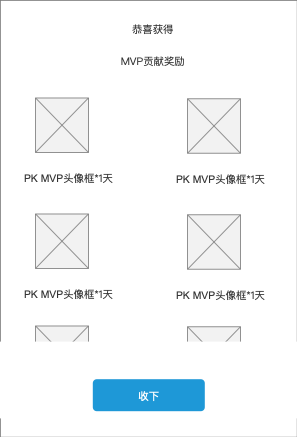
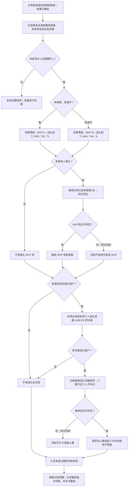
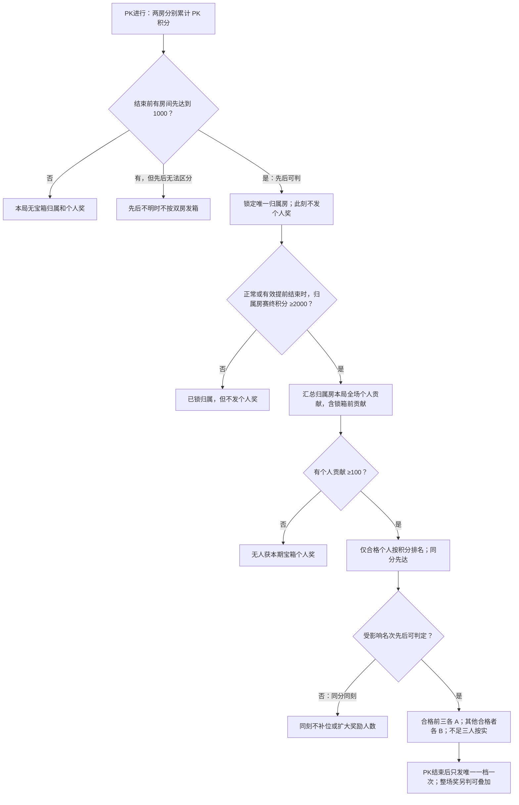

# 房间 PK MVP 奖励需求

本文覆盖房间 PK MVP 的宝箱奖与整场奖；PK 积分、胜负及比赛状态沿用[房间 PK MVP 主需求](房间PK_MVP_需求文档.md)。奖励流程适用于正常结束或有效提前结束且比赛结果已确定的场次。

## 1. 导读与范围

| 奖励来源 | 房间条件 | 个人对象 | 结果的作用 | 发奖时点 |
|---|---|---|---|---|
| 宝箱奖 | 本场先达到 **1000 PK 积分**的唯一房间锁定宝箱；该房赛终积分达到 **2000** 才按本期唯一奖励档发放 | 该房本局个人贡献 **≥100 PK 积分**的用户：前三名各 A，其他合格用户各 B | 胜／败／平不改变宝箱归属或奖励等级 | PK 结束后按最终积分和个人排名自动发放一次 |
| 整场 PK 奖 | **两房分别**判断本房本局流水 **≥y** | 本房确有收礼的收礼积分第1名；本房个人送礼贡献 ≥100 PK 积分后筛出的第1、2、3名 | 按本房胜／败／平确定奖励等级 | PK 结束后核对流水、结果和排名，自动发放 |

- 房间流水与 PK 积分分别统计；整场奖按本房配置的流水门槛 `y` 判断，胜方也须达标。
- 等级字母对应奖品配置，不代表固定物料或时长；宝箱奖与整场奖各自判断，符合条件可叠加。

## 2. 胜负 × 房间条件 × 奖励资格

| 本房比赛结果 | 本房流水 | 整场 PK 奖 | 宝箱奖（单独判断） |
|---|---|---|---|
| 胜 | ≥y | 收礼 MVP：A；送礼 TOP1／2／3：SSS／SS／S；各角色仍须满足实际存在和个人要求 | 仅先到 1000 的归属房，且赛终 ≥2000 并存在个人 ≥100 贡献者时发；否则不发 |
| 败 | ≥y | 收礼 MVP：B；送礼 TOP1／2／3：AAA／AA／A；条件同上 | 同上；败方也可能抢到宝箱 |
| 平 | ≥y | 按败方等级：MVP B；送礼 TOP1／2／3 为 AAA／AA／A；两个房间各自判断 | 同上；平局不撤销已锁定的宝箱归属 |
| 胜／败／平 | <y | 本房**不发整场奖**，不因获胜补发 | 流水不足 y **不影响**独立的宝箱资格 |
| 有效提前结束 | 分别检查 | 按结束时**已确定的比赛结果**、本房流水及榜单判断；发起提前结束方在自有 Axure 中标为默认败方，另一方结果以主 PK 规则的有效结果为准 | 看结束前是否已先到 1000、归属房赛终积分是否 ≥2000、个人是否 ≥100；不以尚未发生的后续冲分补资格 |

**排名与归属：**按用户本房本局的全场贡献统计；同分时先达到当前积分者在前。同刻无法判明先后时，不按并列扩大获奖人数或双房发箱。用户离房后仍按本局结果判断资格，符合条件自动发放。

## 3. 整场 PK 奖：按房间流水、比赛结果和双榜发放

### 3.1 房间门槛与统计

1. 两个房间**分别**检查本房本局 PK 流水是否达到 `y`；低于 `y`，本房收礼 MVP 和送礼前三名奖励均不发，另一房资格不受影响。
2. 达到 `y` 后，按本房的胜、败或平局列选等级。收礼榜按本房本局收礼积分，送礼榜按本房本局个人送礼贡献；两榜不混排。赛中实时榜、结算页头像不是自动获奖凭证。
3. 收礼第一名（MVP）必须确有收礼；无人收礼取消该项，**不要求收礼个人 ≥100 分**。送礼名次奖须由本房本局**个人送礼贡献 ≥100 PK 积分（含 100）**的用户取得；先筛除未达标者，再在合格用户内按贡献排序，人数不足三人按实际人数发，不用未达标用户补位。
4. 两榜同分均按先达到该积分者在前。送礼无个人贡献 ≥100 PK 积分的用户时，不发送礼名次奖；无收礼 MVP 不影响送礼奖的独立判断，反之亦然。

### 3.2 等级矩阵

| 本房获奖对象 | 本房获胜 | 本房战败 | 双方平手 | 个人资格 |
|---|---|---|---|---|
| 收礼积分第一名（MVP） | A | B | B | 本房本局确有收礼；无个人最低 100 分要求 |
| 送礼第一名 | SSS | AAA | AAA | 本房本局送礼贡献 ≥100 PK 积分（含 100）后按贡献排名 |
| 送礼第二名 | SS | AA | AA | 同上，不足人数不补位 |
| 送礼第三名 | S | A | A | 同上，不足人数不补位 |

**奖励弹窗：**标题“恭喜获得”，展示实际获得的奖励类型与奖品。单项居中；多项每行最多两个，超过两行可上下滑动，展示区域随内容适配，不截断奖励项。“收下”不作为自动发奖的前置条件。奖品、数量、有效期按所获等级的配置展示，图中的物料仅为占位。

同一用户同时取得本房收礼 MVP 与送礼名次时，两项分别发放；不得因等级字母相同而合并。

### 3.3 整场奖流程

## 4. 宝箱奖：先锁归属，赛终只发唯一一档

### 4.1 抢箱、发奖与个人排名

1. PK 开始后两房分别累计 PK 积分。**进行期间率先达到 1000** 的房间立即锁定本局唯一宝箱归属；这是房间资格，不在此时发任何个人奖励。另一房以后即使反超或再到 1000，也不能夺走。双方均未在结束前到 1000，则本局无宝箱奖。同刻无法判定先后时，不按双房发箱。
2. 抢到箱子的房间继续累计自身 PK 积分，另一房的积分不合并；达到 **2000** 后具备本期唯一奖励档的房间分数条件。**赛终未达到 2000：仅保留已锁的归属，不发个人宝箱奖；赛终达到 2000：按唯一一档 A／B 发放，之后积分增加不改变该档。**胜败和平局均不改变这一判断。
3. PK 结束时，统计归属房**从开局到结束**每位用户在该房的个人贡献积分，先达箱前贡献也算，多次贡献合计；个人 **≥100（含）**才进入宝箱排名。合格者按贡献降序、同分先达到者靠前。少于三人只按实际人数发，不用不足 100 的用户补位。
4. 房间赛终 ≥2000 且至少一名用户合格时，**合格的贡献第1、2、3名各发 A**；其余每位合格用户**各发 B**。前三不再领“其他用户 B”。赛终零合格个人不发宝箱个人奖。**只在赛终自动发放这一档一次**，离房无需回房领取；不以抢箱前后时间切段替代全场贡献统计。

| 归属房赛终是否达到 2000 | 合格贡献前三 | 其余个人贡献 ≥100 的用户 | 本期处理 |
|---|---|---|---|
| 否 | 不发 | 不发 | 只有抢箱归属，没有满足唯一发奖条件 |
| 是 | 每人 A，不足三人按实际人数 | 每人 B | 按唯一一档结算一次；更高积分不改变等级 |

### 4.2 宝箱流程

## 5. 叠加、展示与履约

| 场景 | 本期处理 |
|---|---|
| 同一用户同时符合宝箱与整场送礼奖 | 两项分别发；整场奖需该房流水 ≥y、用户本房本局送礼贡献 ≥100 PK 积分且进入合格者前三；宝箱不受 y 限制 |
| 同一用户同时符合宝箱与整场收礼 MVP | 两项分别发；仍各自核对资格 |
| 同一用户为收礼 MVP、送礼前三且符合宝箱条件 | 所有符合的不同来源／角色奖励可叠加；同一宝箱内前三 A 与“其他用户 B”互斥 |
| 宝箱归属锁定后继续累积分数 | 先锁资格；赛终达到 2000 才满足唯一一档发奖条件；赛终一次结算 |
| 用户在 PK 中途离房 | 不因离房取消资格；结束后符合条件自动发放，无需回房手动领取 |
| PK 有效提前结束 | 按结束时已确定的房间归属、积分、流水、排名和比赛结果处理；不足门槛不补发 |
| 重复发放请求 | 同一场、同一房、同一用户、同一奖励来源／角色不得重复到账；重试不产生新增奖励 |

**展示与发奖：**先达目标后双方抢箱进度冻结，房间 PK 积分继续累计至比赛结束。结算页头像不作为获奖资格或到账凭证；实际奖励按最终资格及等级配置展示，点击“收下”不作为发奖前置条件。
