# 房间PK MVP 需求文档

## 模块索引

本期范围：房间PK，不包含个人PK或新增的其他PK形态。

| 序号 | 模块 |
|---|---|
| 01 | 房间PK入口 |
| 02 | 选择对手与推荐房间 |
| 03 | 按房间ID搜索 |
| 04 | 随机匹配中 |
| 05 | 无相同时长的匹配提示 |
| 06 | PK设置 |
| 07 | 已发送邀请 |
| 08 | 收到PK邀请 |
| 09 | 开局3秒倒计时 |
| 10 | 进行中：双方互搏 |
| 11 | 进行中：单方加分 |
| 12 | 结束前30秒 |
| 13 | MVP贡献奖励 |
| 14 | MVP魅力奖励 |
| 15 | 率先完成目标奖励 |
| 16 | 胜利结算 |
| 17 | 平局结算 |
| 18 | 60秒结算阶段与下一局 |
| 19 | 恢复房间麦位 |
| 20 | PK战绩 |
| 21 | 跳转对方房间观战确认 |
| 22 | 提前结束PK |
| 23 | 失败结算 |
| 24 | 首页PK展示 |
| 25 | 管理员权限设置 |

## 1. 产品范围

房间之间通过定向邀请或随机匹配建立PK，经过3秒准备后进入对战；按本场规则计分，结束后展示结果、奖励及战绩，并支持恢复普通房间或向原对手再邀。

本期覆盖首页PK展示、管理员PK权限设置、房间内入口、推荐/搜索、随机匹配、设置、邀请/接邀、准备、对战计分与展示、胜负结果、60秒结算转场、麦位恢复、战绩、跨房观战、提前结束PK及独立失败结算，以及相关配置/异常边界。奖励按双方独立达标A与唯一先达房简化抢箱C分别结算；旧三档和最终胜方个人奖不属本期。不因房主/管理员身份扩展全部PK操作权。

## 2. 角色与操作权限

| 身份 | 房间内PK入口 | 发起PK的权限边界 |
|---|---|---|
| 本房间房主 | 可见 | 可发起；仍须满足房间模式、黑名单及其他发起资格 |
| 本房间管理员，已获得单独PK授权 | 可见 | 可在已授权操作范围内发起；管理员身份不代替PK授权 |
| 本房间管理员，未获得单独PK授权 | 不可见 | 不得仅凭管理员身份发起PK，旧页面也不能继续执行未授权操作 |
| 普通观众或无本房间管理身份的用户 | 不可见 | 不得通过本房间管理入口发起PK |

管理员设置页新增独立「PK」权限项（见4.25）；PK授权由当前有效权限决定。房主目前不可变更。PK过程中管理员PK权限被移除后，限制其后续PK权限相关操作；不据此自动撤回邀请、取消准备或结束比赛。取消随机等待跟随PK权限，并同时受原发起者限制；首次收到邀请时，接收房房主及具有PK权限的管理员可以接受或拒绝，以最先操作者为准。已成局PK跟随房间完成，不因管理员权限或身份变更中断。“结算期再来一局、立即结束”按当前PK权限及当前链路限制分别判断。

## 3. 全局业务规则

| 事项 | 确定规则 |
|---|---|
| 房间模式 | 休闲游戏模式、观影房模式隐藏PK入口，且不能发起PK；推荐候选同时过滤这些房间。不直接扩写为比赛中强制结束或自动切换模式 |
| 管理员PK授权 | 管理员设置页新增独立PK权限项（4.25）；未授权管理员不显示PK入口；权限撤销后限制其后续PK权限相关操作 |
| 首页PK展示 | 正在PK的房间队列轮播，间隔3秒；两房当前PK分数之和降序；进入房间时过滤剩余PK时长不足60秒的场次；无PK中房间时隐藏模块。房间卡片与连胜标签见4.24 |
| 房间ID展示与查找 | 本文所有房间ID展示遵循：房间房主有靓号时优先展示房主靓号ID，否则沿用原房间ID；支持靓号查房，同时保留原房间ID查找，详见3.1 |
| 等待期间操作人 | 本房已发邀请或随机匹配等待倒计时期间，由原发起者本人继续操作；其他成员即使有PK权限也不得代操作，提示“有其他成员正在进行PK操作，无法继续操作PK。” |
| PK黑名单 | 服务端手动将房间加入PK功能房间黑名单数据库表；不新增客户端或后台管理页面。名单房间不得使用PK功能，与私人拉黑分开 |
| PK模式排麦方式 | 可选自由麦、排麦模式；记住上一次设置，未设置过默认排麦模式。自由麦无需房主审批即可上空缺麦位；排麦模式需房主或管理员审批后分配到空缺麦位，复用已有两种排麦逻辑，详见4.6、4.10 |
| 邀请不可撤回 | 邀请发出后不可撤回；本次邀请从发起起总有效期30秒，未接受即废弃；拒绝或到期结束本次等待。被拒后可立即向另一房发起 |
| 开局准备 | 有效接受邀请或随机命中后进入不可取消的3秒动画；播完自动进入正式PK，无需双方就绪确认，动画播完前不计PK积分 |
| 旧局结果核对 | 旧局结果尚未核对完成时，不允许发起或接受下一局邀请；发起与接受两个时点均校验。退出展示不能绕过该限制；A/C部分权益履约失败与结果未核对分开 |
| 正常结算与庆祝 | 到零或有效提前结束停止收分，分数结算完成后播放结果表现、展示结果弹窗并进入60秒结算；庆祝15秒独立，结算送礼不加PK分；庆祝未播完时他人不得向该房发邀 |
| 结算专用按钮 | “再来一局、立即结束”仅结算阶段且当前有PK权限时可见；操作仍受邀请/匹配等待原发起者限制，不等同于进行中的提前结束 |
| 进行中提前结束PK | 发起提前结束的一方默认失败；生效后立即结束本场PK并进入结束流程，详见4.22；不沿用双房征询后按中止处理的旧方案 |
| 立即结束结算展示 | 任意一方有权限且满足当前操作人限制的用户点击后，双方退出旧局结算展示、恢复房间布局；不改变已核定结果或取消奖励 |
| 结算期再邀 | 旧局结果核对完成后，可在旧结算展示尚未结束时向原对手发新邀请；对方有效接受后立即进入不可主动取消的3秒准备，随后开始新局 |
| 再邀等待与展示退出 | 已发、未响应邀请不因立即结束或60秒到时而撤回、失效；继续原有效期并保留邀请占用，未获响应前不视为开局 |
| 旧场与新场隔离 | 新局进入准备或进行中后，旧场按钮、旧场到时事件不得结束或影响新局 |

### 3.1 权限与资格复核

| 操作 | 房主 | 管理员 | 普通观众/普通麦上成员 |
|---|---|---|---|
| 普通PK入口、从入口发起、战绩再次发起 | 按当前资格可见并操作 | 普通PK入口须已获独立PK授权才可见；各路径执行发起仍复核权限与操作人限制 | 无管理入口/按钮 |
| 随机等待中取消 | 具备当前PK权限且为本次匹配原发起者 | 同左，不能代其他发起者取消 | 无管理操作权 |
| 首次接受/拒绝邀请 | 接收房房主可以接受或拒绝，以最先操作者为准 | 接收房具当前PK权限的管理员可以接受或拒绝，以最先操作者为准；已有等待仍受原发起者限制 | 无管理操作权 |
| 结算阶段再来一局/立即结束 | 当前有PK权限时可见；操作还须满足本房等待原发起者限制 | 同左，管理员身份不能替代授权或原发起者 | 无按钮 |
| PK麦位布局下管理本方麦位（锁麦、闭麦、将用户下麦、邀请用户上麦） | 保留既有管理能力 | 保留既有管理能力，不因进入PK麦位布局而失效 | 不因进入PK获得房主或管理员的麦位管理权 |
| 控制对方声音是否在本房播放 | 可控制 | 可控制 | 本房开启后可个人静音/取消静音，不改变本房总开关 |
| 观看比赛、查看榜单、按原有能力送礼 | 沿既有房间能力 | 沿既有房间能力 | 沿既有房间能力，不因观看获得管理权 |

实际发起、接受及开局均按当前身份、PK权限、房间资格、PK黑名单和有效链路状态复核；发现列表、旧页面或旧弹窗不代替复核。仅可邀请本大区房间；私密房不影响邀请资格，但邀请不替代实际入房权限。休闲游戏/观影房不能发起，推荐候选过滤游戏/观影房；管理员撤权后本人不能继续权限相关操作；MVP不为等待期撤权额外设计接管、通知或特殊取消，邀请仍守总30秒有效期，已成局PK继续跟随房间；房主不可变更，不再保留房主转让接管路径。PK黑名单不是私人拉黑关系。

**房间ID统一口径：** 推荐、搜索、已发/收到邀请、匹配或对阵信息、进行中面板、结果、结算及战绩中，凡展示房间ID均优先使用该房间房主的靓号ID，无靓号沿用原房间ID；支持输入靓号查找其房间，也保留原房间ID查找。靓号只是展示及查找入口，不将房间、个人或历史场次的业务归属改成靓号。

**PK操作人限制：** PK发起及其后续操作由同一人进行。本房一人已经发起邀请或随机匹配，在等待对方响应倒计时或匹配倒计时期间，非该发起者本人不得再发起、操作当前PK链路或代为取消匹配、处理异时长选择、修改PK设置；即使是房主或其他有PK权限管理员也不能代操作。触发时统一提示“有其他成员正在进行PK操作，无法继续操作PK。”。本人仍须具备当前对应权限，且不因此获得撤回邀请或取消3秒准备的能力。此规则覆盖推荐、搜索、随机、战绩和结算再邀入口，不以换页、多端或退出旧结算展示绕过。已确定限制以邀请/匹配等待期间为边界，准备、进行中及无等待链路的结算操作仍按各阶段规则处理，不擅设全程永久锁或自动接管。

旧局结果未核对完成的限制适用于结算期再邀、战绩再邀及其他下一局邀请路径。随机路径仍须校验自身资格与占用。

### 3.2 状态、时间与占用

“结果核对”“结算展示”“下一局邀请”分开记录，不能合成一个笼统的“结算中”。同一房间可以正在展示旧局结果，同时等待原对手响应下一局邀请；这不代表可以同时匹配第三房。

| 状态/维度 | 进入及可执行动作 | 退出和约束 |
|---|---|---|
| 对手发现 | 浏览推荐、搜索房间或打开设置 | 单纯浏览不发送邀请、不启动匹配、不创建PK场次 |
| 随机匹配等待 | 双方主动入池；本房原发起者具备当前PK权限时可取消，其他成员不得代操作 | 全程匹配上限60秒，预估等待默认60秒；无同长弹窗10秒未响应自动退出。真正同时的竞争随机择一生效 |
| 定向邀请等待 | 创建邀请后等待对方有效接受/拒绝；从发起起总有效期30秒 | 发起方不可撤回；未接受到期废弃，拒绝或到期结束本次等待并释放相应占用；被拒后可立即邀另一房 |
| 3秒开局准备 | 邀请有效接受或随机命中后进入 | 不可主动取消；3秒动画播完自动开赛，不需要双方确认就绪或等待可靠就绪；动画播完前不计PK积分 |
| 对战进行中 | 按本场时长对战，展示积分、成员和榜单 | 正常到时停止旧局计分；提前结束按4.22立即结束且发起方默认失败 |
| 旧局结果核对 | 正常到零或有效提前结束后完成分数结算，不设正常长期核对等待 | 真实故障导致结果无法确认时不伪造胜负，提前结束已确认的发起方失败事实保留；未确认结果前禁止发起/接受下一局邀请 |
| 60秒结算展示 | 分数结算完成后结果表现、结果弹窗与60秒结算同步进入；结算送礼不增加PK积分 | 有权限且满足操作人限制者立即结束、系统到时退出，或有效再邀接受转新局3秒准备；庆祝15秒独立且未播完时他人不得向该房发邀 |
| 已结束的旧局 | 可靠结果与旧局结束事实保留 | 历史读取该场结果；存在有效下一局邀请时不因旧展示退出而释放其占用；旧事件不得作用于新场 |

| 时间项 | 当前规则 | 约束 |
|---|---|---|
| 本场时长 | 可用档位由服务端配置，默认20分钟 | 旧选择被移除则关闭设置弹窗并提示“时长选项已更新，请重新设置。”；后续发起/匹配使用新默认档位 |
| 异时长随机命中 | 本房原发起者选择继续匹配后扩大候选，无需双方额外同意；双方仍须主动入池，命中取双方所设时长中较长值 | 不代替对方主动入池，不修改长期设置，不扩写为定向邀请取长 |
| 3秒准备 | 有效成局后播放，播完自动开赛，不可主动取消；动画播完前不计分 | 不设双方就绪或准备超时门槛 |
| 发起冷却 | 发起后30秒内不得向其他对象发起；被拒后可立即向另一房发起 | — |
| 随机匹配与异时长弹窗 | 全程匹配60秒、预估默认60秒；检索无同长即提示，选择窗10秒未响应自动退出 | 弹窗不延长全程60秒；真正同时的竞争随机择一生效 |
| 邀请 | 邀请从发起起总30秒未接受废弃；3秒动画后自动开赛 | — |
| 正常结算 | 分数结算完成后结果表现/结果弹窗与60秒结算开始 | 不是延长比赛的60秒，期间送礼不增加本场PK积分，15秒庆祝结束不结束整个阶段 |
| 麦上庆祝 | 15秒，结算阶段内的独立动画 | 动画结束不直接触发退出整个结算阶段 |

**占用与并发：** 邀请/匹配等待期间由原发起者独占操作，非本人操作使用3.1指定提示，本人也不得重复创建有效链路。真正同时的竞争随机择一结果统一生效，非同时按已生效状态处理；首次接邀接受/拒绝以最先操作者为准，不用随机翻转已生效响应。旧展示可以与向原对手的待响应邀请并存；展示退出后该邀请仍有效、保留占用和操作人限制，不放开第三方。双方同时点再邀不自动互相接受，也不生成两场；旧邀请/旧按钮不能覆盖已完成的响应或新局。

### 3.3 PK计分与榜单

#### 3.3.1 计分规则

| 内容 | 本期口径 |
|---|---|
| 非幸运礼物基础计分 | 赠送非幸运礼物：1金币=1PK积分 |
| 幸运礼物基础计分 | 赠送幸运礼物：10金币=1PK积分，按该份礼物对应金币价值除以10计算基础PK积分，不按幸运返奖或净损耗改算 |
| CP礼物特殊计分 | CP礼物允许赠送给不在本房间的对象；赠送CP礼物统一计入送礼方所在房间的PK积分，不随收礼对象所在房间转移；计入数值同非幸运礼物，即1金币=1PK积分 |
| 金币价值边界 | 非幸运礼物及CP礼物1金币=1PK积分；幸运礼物10金币=1PK积分 |
| 房间总分 | 本场归属该房间的有效礼物积分之和；CP礼物按送礼方所在房间归属，不因收礼对象在外房改计到外房。支持者按送礼贡献累计，收礼成员按本场收礼积分累计，两榜分开 |
| 最后30秒 | 所有礼物PK积分增加10%；只增加PK分，不增加礼物资产、收礼收益或工资，不把先前累计总分整体乘1.1 |
| 首赠提示 | 本局PK分数为0时显示“首次赠送礼物+10%”；与末30秒加成不能叠加 |
| 计分对象 | 麦上用户一定计入；麦下用户收送礼是否计入由服务端控制。CP礼物不得仅因收礼对象不在本房间或本房麦位而排除本房积分 |
| 成员变化 | 已发生有效PK分不因麦位成员上/下麦、离房或切房而增减/迁移 |
| 两房贡献展示 | 各房显示本场送礼分数前三用户头像；同分先达到者靠前。收礼分数最高用户标记MVP，不固定等于房主、不把送礼前三称为收礼前三 |

**单份基础PK积分 = 该份有效礼物金币价值 ÷ 本类兑换基数。** 非幸运礼物兑换基数为1，幸运礼物为10；CP礼物按非幸运礼物口径，兑换基数为1。

**单次有效赠送PK积分 = 本次有效赠送基础PK积分 × 本次唯一有效倍率。** 选择多人赠送多个礼物仍为一次赠送；按有效礼物分类换算基础分后汇总，不拆为跨末30秒的多次动作，不把幸运礼物继续按1:1计分。

倍率不加成时为1；命中首赠资格或末段加成时为1.1；两项不相加为1.2，不连乘为1.21。房间总分、送礼贡献、收礼贡献使用同一份分类换算后的礼物积分，不得因同笔多条消息重复记分。CP房间总分归送礼方本房。

送礼和收礼同分均按先达到者靠前；贡献人数不足3人只展示实际人数，不补虚拟用户。不考虑历史退款，不扩展结算后追溯改判；已定胜利不改作平局或重新提前结束。同场结果不能重复累计连胜。

### 3.4 胜负、结果与连胜荣誉

- 正常到时后，按双方可靠核对的最终积分比较：高分方胜、另一方负；相同则平局，双0分也属于同分，不能依据动画、百分比或客户端先返回的结果判胜。
- 提前结束按4.22执行：发起本次提前结束的一方默认失败，生效后立即结束本场并进入结束流程，不按当时积分改判胜或平；不是把最初发送PK邀请的一方固定判负。
- 到零或有效提前结束后停止收分并完成分数结算，随后结果表现、结果弹窗及60秒结算同时进入；正常流程不设长期核对等待。真实故障下胜负依据不可靠时不展示确定胜负；“核对中”本身不等于平局、中止或判负。提前结束已生效的失败事实不因比分/榜单仍在核对而消失，也不由未核对分数重新判定；未完成核对仍禁止发起/接受下一局邀请。实际截单后的礼物不得回流旧局。
- 胜/负/平、比分、榜单、比赛结束原因属于同一场结果；结果窗、结算阶段和战绩不得各自重算出不同结果。无可靠胜负的异常中止不是普通失败，不能凭临时分数决定胜负；4.22已明确判负的提前结束不再归入该类中止。
- 房间封面/名称区域与PK顶部保留房间连胜荣誉，展示同一当前次数；连胜不是个人奖励物料。首页PK横幅与房间卡片中，一周内PK连胜3次的房间显示PK连胜标签，详见4.24。

**奖励与胜负分离：**每个最终达标房独立获得A资格：该房赛终送礼贡献第1/2/3名及收礼榜首MVP Host，四个角色位分别对应四款不同样式的1天头饰框；败方达标照领，人数不足不补位，同人兼送礼名次与Host分别保留对应资格。C仅本场唯一先达到PK积分目标的房间额外取得抢箱期间送礼积分TOP3各1天道具、期间送礼PK积分≥10000的用户各1天参与道具；A看赛终榜，C看先达时的期间榜，不能混用。C两类资格可同人命中，亦可与A并存。**不发最终胜方个人奖励**，房间连胜与胜负照常保留。

### 3.5 PK主流程

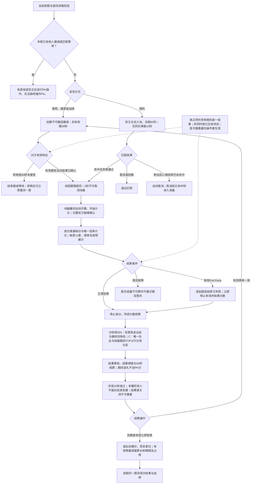

### 3.6 详细流程索引

| 阅读问题 | 对应详细流程 |
|---|---|
| 谁能看到入口、受限后去哪里 | 4.1.5 入口资格与页面衔接 |
| 搜索结果能否发邀，异常去向是什么 | 4.3.5 搜索与邀请 |
| 同长/异时长如何配对，取消与命中怎么区分 | 4.4.5 随机匹配；4.5.5引用异时长分支 |
| 发邀后如何接收、拒绝、到期和进入准备 | 4.7.5 定向邀请闭环；4.8.5引用接邀分支 |
| PK排麦方式如何回显，用户如何上麦 | 4.6.5 排麦方式设置与上麦；4.10.3～4.10.4进行中衔接 |
| 接受/命中后如何播放3秒并自动开赛 | 4.9.5 开局准备 |
| 礼物是否计分，倍率/归属/榜单如何关联 | 4.10.5 有效礼物计分；4.12.5引用末段分支 |
| 双方互搏和单方攻击如何切换 | 4.11.5 对抗表现 |
| 截单后如何核对并得到胜负/平局 | 4.16.5 结果核对；4.17.5引用平局分支 |
| 双房达标A、唯一抢箱C如何定榜与发奖 | 4.13～4.15奖励模块；3.4全局口径 |
| 结算结束与待响应再邀如何独立处理 | 4.18.5 结算退出与下一局邀请 |
| 恢复布局后哪些占用仍保留 | 4.19.5 恢复麦位与占用 |
| 从战绩如何读取结果并重新邀请 | 4.20.5 战绩与再邀 |
| 跳房确认、取消和房间失效如何分流 | 4.21.5 跨房观战 |
| 进行中提前结束如何判负并进入结束流程 | 4.22.5 提前结束PK；6.1结果衔接 |
| 失败结果如何展示及与提前结束衔接 | 4.23.5 失败结算；4.16.5共用结果核对 |

## 4. 客户端功能模块

### 4.1 房间PK入口

#### 4.1.1 页面定位与前置条件


- PK入口位于房间内，位置调整为**礼物按钮左侧**。

- 本模块只新增/调整PK入口及其规则，不把房间背景中的头像、余额、麦位、聊天、公屏、礼物数量等既有信息扩写成本期新增字段。

- 不新增独立的“房间PK管理页”、授权管理页或黑名单管理页；PK房间黑名单由服务端手动维护。房主目前不可变更。

#### 4.1.2 页面展示与字段

| 内容或判定项 | 来源 | 展示或业务含义 |
|---|---|---|
| PK入口图标 | 房间PK入口 | 作为进入房间PK功能的触发入口；位置在礼物按钮左侧 |
| 当前房间 | 用户当前所在房间 | 决定本次入口属于哪个房间，不跨用其他房间的身份或授权 |
| 当前管理身份 | 当前房间的房主/管理员身份 | 房主及已获得独立PK授权的管理员才满足身份权限可见条件；未授权管理员、普通观众不显示 |
| 当前PK授权 | 当前有效的管理员PK授权 | 未授权管理员隐藏入口；实际操作仍须复核对应授权，不能只判断管理员身份 |
| 当前房间模式 | 当前房间正在使用的模式 | 休闲游戏、观影房等不支持PK的模式下隐藏入口且不允许发起；不新增自动退出原模式的流程 |
| PK黑名单状态 | 服务端手动维护的PK房间黑名单 | 房间在名单中时不得使用PK功能，不改用私人拉黑关系替代 |
| 旧局结果核对状态 | 该房间上一局尚未完成的结果核对情况 | 未核对完成时，不能发起或接受下一局邀请；不以展示关闭或到时替代核对完成 |

上表的资格信息用于判定，不要求作为新字段展示在房间页面。

#### 4.1.3 用户交互

| 用户操作 | 页面反馈/去向 |
|---|---|
| 进入本房间 | 在支持PK的模式下，房主及已获独立PK授权的管理员可见普通PK入口，位置在礼物按钮左侧；未授权管理员、普通观众不显示 |
| 点击PK入口，资格通过 | 进入“选择对手与推荐房间”页面；只是打开页面，尚未发送邀请、匹配或开局 |
| 未授权管理员进入房间，或房间使用不支持PK的模式 | 隐藏PK入口；旧页面不能绕过当前权限或模式限制 |
| 黑名单/旧结果核对限制未通过 | 不产生有效发起 |
| 当前邀请或随机匹配等待期间，其他管理者尝试操作PK | 即使有PK权限也不能代替原发起者操作，提示“有其他成员正在进行PK操作，无法继续操作PK。” |

#### 4.1.4 服务端核心逻辑

**入口资格与有效权限**

1. 普通PK入口仅向本房间房主和已获得独立PK授权的管理员显示；未授权管理员及普通观众隐藏入口。其他资格仍须复核，入口可见不等于当前可以发起。
2. 房主或管理员执行PK操作时，以当前房间、当前身份、当前授权为准。旧页面、多端缓存、曾经担任房主/管理员，均不能替代当前有效权限。
3. 休闲游戏模式、观影房等不支持PK的模式下隐藏PK入口并禁止发起，不自动切换模式。
4. PK房间黑名单由服务端手动加入数据库表维护；被列入名单的房间不得使用PK功能。
5. 当前仍有旧局结果未核对完成时，不允许发起或接受下一局邀请。60秒结算展示结束、“立即结束”或关闭结果弹层均不能解除该限制。
6. 入口点击本身不等于发送邀请、进入随机匹配或开始PK；后续模块的发起/接受操作仍须重新校验对应资格，不能只沿用打开入口时的判断。
7. 当前邀请或随机匹配等待期间，只允许原发起者在当前有效权限范围内操作PK。其他管理者即使有PK权限也不可替代，提示原文“有其他成员正在进行PK操作，无法继续操作PK。”；本人仍须复核权限，不因原发起者身份获得撤回定向邀请或取消3秒准备的能力。此限制仅明确等待期间，不扩为比赛全程永久锁或接管策略。
8. 房主目前不可变更；管理员被移除或PK授权被撤销后，限制其后续PK权限相关操作；成局后PK跟随房间继续，不因管理员身份或权限变更而终止。等待期间撤权不另行设计接管、终止或通知方案。

**受限后的业务结果**

- 未获对应发起授权或处于禁止发起的房间模式时，不产生有效发起邀请，不因入口点击进入新局准备。
- 旧结果未核对完成时，不产生新邀请或有效接受，不得通过下一局邀请进入准备；普通房间能力与PK资格分开。
- PK黑名单禁用不得通过普通入口、搜索、推荐或随机路径绕过；不据此自动处置已经存在的场次。
- 入口点击不会自动切换房间模式。

**状态变化时的处理规则**

| 状态或变化 | 本模块约束 | 范围边界 |
|---|---|---|
| 无管理身份 | 不显示普通PK入口；不得通过旧页面代替当前身份执行发起 | 不新增获得身份的引导流程 |
| 有管理身份但无PK授权 | 未授权管理员隐藏入口；不得通过旧页面执行无权限操作 | 不新增授权引导流程 |
| 管理员PK权限撤销或管理员被移除 | 限制该成员后续PK权限相关操作，旧页面不能继续授权；成局后PK跟随房间继续 | MVP不另行设计撤权后的接管或通知；等待期间其他管理者不可替代，不新增撤回邀请或取消准备 |
| 房主身份 | 目前不可变更 | 不新增房主变更或继承流程 |
| 当前邀请或随机匹配等待中，其他管理者尝试操作 | 即使有权限也不可替代原发起者，提示“有其他成员正在进行PK操作，无法继续操作PK。” | 不扩为比赛全程永久锁或其他阶段接管策略 |
| 房间模式发生变化 | 不支持PK时隐藏入口；实际发起仍复核，不凭旧页面放行 | — |
| PK黑名单发生变化 | 当前名单资格参与后续PK操作校验 | — |
| 多端或重复点击 | 打开入口本身不创建邀请、不触发开局；旧身份不能覆盖当前权限 | 邀请与开局的并发规则在后续模块定义 |
| 旧局进入结果核对中 | 仅针对结果无法核验等故障保留未核对事实，禁止发起/接受下一局邀请；不以恢复普通房间替代资格恢复 | 不作为正常赛后等待门槛 |
| 后续发起时资格不满足 | 不产生有效邀请或有效接受，不能使用先前打开页面时的结果放行 | — |

本模块没有定义成功送礼、原局结果或奖励的变更行为。不能因入口不可用而回退既有积分、撤销奖励或主动结束比赛。

#### 4.1.5 业务流程

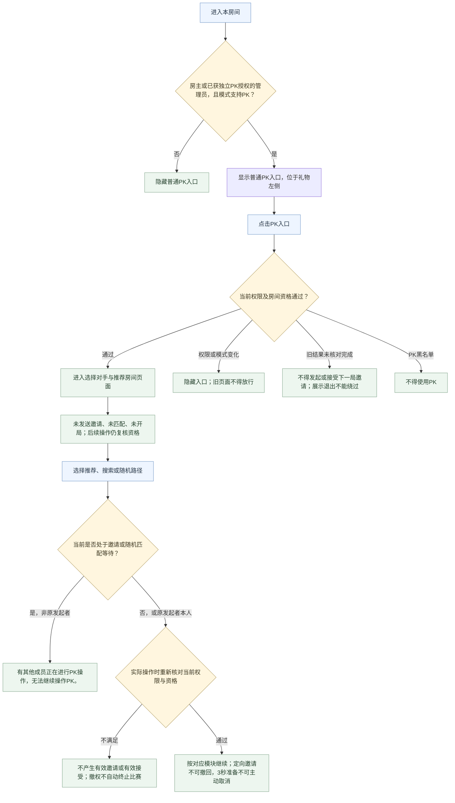

#### 4.1.6 状态与异常

普通PK入口分为可见与当前可发起两层：未授权管理员、不支持PK的房间模式隐藏入口；其他资格仍在实际操作时复核。管理员撤权限制后续PK权限相关操作，不自动终止比赛。当前邀请/随机等待期间，其他管理者不可替代原发起者；本人也不豁免权限复核。

### 4.2 选择对手与推荐房间

#### 4.2.1 页面定位与前置条件

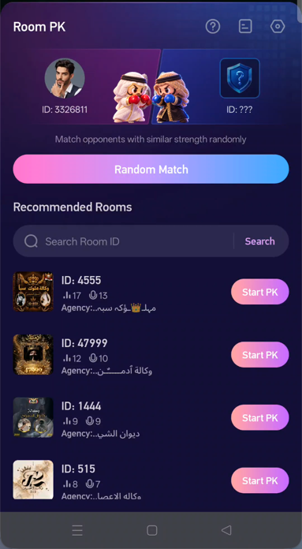

- 从本房间PK入口进入，页面标题为“Room PK”。

- 本页用于选择对手、进入随机匹配及按房间ID搜索；打开页面不等于已发邀请或已开始PK。

- 普通观众不通过本页获得发起、设置或其他比赛管理操作；未授权管理员及不支持PK模式下的入口隐藏规则见4.1。

- 页面中的所有房间ID均按房主有靓号时优先展示靓号，否则沿用原房间ID；搜索同时支持靓号和原房间ID，不新增号码唯一性、冲突或改号规则。

#### 4.2.2 页面展示与字段

| 区域 | 内容及来源 | 展示含义 |
|---|---|---|
| 顶部 | Room PK标题；规则、战绩、设置入口 | 分别承接规则说明、PK战绩和PK设置，不在本页展开对应功能 |
| 对手示意 | 本房头像和ID；另一侧问号及未知ID | 尚未选定的对手不能作为已匹配房间展示 |
| 随机入口 | Random Match及随机匹配说明 | 主动进入随机等待 |
| 推荐区域 | Recommended Rooms | 本大区候选按当前麦上人数从高到低排序，20条/页；进入本页刷新，无候选显示空状态 |
| 搜索区域 | Search Room ID输入提示、Search | 支持靓号查房，同时保留原房间ID查找，详见4.3 |
| 候选资料 | 房间图片、ID、左侧热度值图标、右侧当前麦上人数图标、Agency信息 | ID遵循靓号优先规则；热度值与当前麦上人数进入页面后更新，Agency显示房间所属公会名称 |
| 候选操作 | Start PK | 对对应房间发起定向邀请，而不是直接开始计分 |

#### 4.2.3 用户交互

| 用户操作 | 页面反馈/去向 |
|---|---|
| 点击候选的“Start PK” | 资格通过并成功发送后进入4.7待响应状态，不直接开始计分；对方正在PK时显示“该房间正在PK中” |
| 输入靓号或原房间ID并点击“Search” | 进入4.3搜索结果流程 |
| 进入本页查看推荐 | 刷新推荐候选及热度值、当前麦上人数；按麦上人数降序展示，20条/页，无候选显示空状态 |
| 当前邀请或随机匹配等待期间，其他管理者尝试操作PK | 即使有权限也不可替代原发起者，提示“有其他成员正在进行PK操作，无法继续操作PK。” |
| 点击“Random Match” | 衔接4.4随机等待；暂无同长候选时先展示4.5征询 |
| 点击规则、战绩或设置入口 | 分别衔接规则说明、PK战绩及4.6设置 |

#### 4.2.4 服务端核心逻辑

- 发起身份与独立PK授权见3.1，房间状态、旧局核对及占用限制见3.2。

**业务处理规则**

1. 推荐候选仅限本大区，过滤本房间、不接受PK邀请的房间、房间人数为0的房间、正在PK的房间，以及游戏房、观影房；私密房不影响邀请。原有PK黑名单及资格限制仍须遵守。
2. 候选按当前麦上人数从高到低排序，进入本页刷新，分页20条/页，无候选显示空状态。热度值、当前麦上人数进入页面后更新，Agency取房间所属公会名称。过滤中的“房间人数为0”、本页“麦上人数排序”和随机匹配“在麦人数差最小”是不同口径，不互相替换。
3. 点击候选“Start PK”时，重新核对操作者当前权限、两房PK黑名单及资格、本大区与模式限制、邀请偏好和当前状态；私密房身份本身不阻止邀请。
4. 旧局结果尚未核对完成时不得发起下一局邀请；不能因本页已经打开而放行。
5. 发起后30秒内不得向其他人发起PK；该定向邀请被拒绝后可立即邀请另一房，不锁住剩余30秒。其他冷却边界见4.7，不在推荐路径另设口径。
6. 对方已在PK时拦截发起，提示原文“该房间正在PK中”。
7. 定向邀请按本房设置时长发送；成功发送后衔接4.7，不套用随机异时长取长规则。
8. 当前邀请或随机匹配等待期间，只原发起者可在当前权限范围内操作PK；其他管理者即使有PK权限也不可替代，提示“有其他成员正在进行PK操作，无法继续操作PK。”。本人仍须复核权限，不能撤回定向邀请、不能取消3秒准备，不扩为比赛全程永久锁。
9. 本房与候选房间的ID展示均遵循房主有靓号优先靓号、否则原房间ID的规则；查找同时保留两种号码，不新增唯一性、冲突或改号规则。
10. 所选时长档位已被服务端移除时，后续发邀或发起匹配采用新的默认档位，见4.6；不据此改动已有比赛时长。旧局庆祝尚未播完时，其他房间不能向该房间发起PK。

**状态变化与异常处理规则**

| 场景 | 本模块处理边界 |
|---|---|
| 列表显示后对方进入PK或关闭接邀 | 按发起时当前状态复核，旧列表不能保证邀请成功 |
| 当前管理身份、授权或黑名单资格变化 | 不允许旧页面继续执行已无权或无资格的发起 |
| 推荐候选暂缺 | 显示空状态；不编造具体空态文案或新增按钮 |
| 推荐、搜索和随机被同时操作 | 已有等待链路时先执行原发起者限制；非同刻按已生效状态处理，确实同时的竞争随机选择一方结果唯一生效，不创建多条链路 |

#### 4.2.5 业务流程

进入本页先按本大区及既有条件过滤候选（含游戏房、观影房，私密房不因私密属性排除），刷新热度值与当前麦上人数，再按麦上人数降序、20条/页展示；无候选显示空状态。等待期间先校验是否原发起者，其他管理者按指定提示拦截，本人仍复核权限。后续详见4.3.5“搜索并邀请”、4.4.5“随机匹配”和4.7.5“定向邀请闭环”。本页推荐“Start PK”适用4.7的发送分支；“Search”适用4.3查找分支；“Random Match”适用4.4等待与异时长征询分支。单纯打开本页不进入任一有效邀请或开局状态。

#### 4.2.6 状态与异常

推荐无候选时显示空状态。进入页面刷新候选、热度值及当前麦上人数。列表不是邀请成功凭据。资格变化、等待期间原发起者限制及跨路径竞争见4.2.4。

### 4.3 按房间ID搜索

#### 4.3.1 页面定位与前置条件

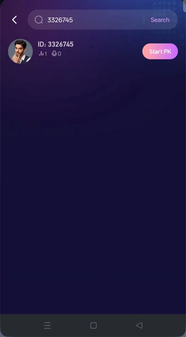

- 从选择对手页输入靓号或原房间ID并搜索后进入本页；顶部保留返回入口、输入区域和“Search”。

- 本模块只定义按房间ID查找及对结果发起定向邀请，不将用户ID搜索或昵称搜索并入本期。

#### 4.3.2 页面展示与字段

| 内容 | 来源与含义 | 边界 |
|---|---|---|
| 房间ID输入 | 用户输入的靓号或原房间ID | 两种号码均支持查房 |
| Search | 发起房间ID查找 | — |
| 结果头像 | 对应房间现有资料 | — |
| ID | 查找到的房间标识 | 房主有靓号时优先展示靓号，否则沿用原房间ID；仍支持原房间ID查找，不以头像或昵称代替标识 |
| Start PK | 对该结果执行定向邀请 | 需要提交时复核，不能以搜索成功替代资格通过 |
| 返回入口 | 离开搜索页 | 返回不构成发送邀请；存在已发邀请时不能借返回撤回 |

#### 4.3.3 用户交互

| 用户操作 | 页面反馈/去向 |
|---|---|
| 输入靓号或原房间ID后点击“Search” | 两种号码均可查房，结果ID按靓号优先展示 |
| 点击结果“Start PK” | 资格通过并成功发送后衔接4.7，尚未开局；对方正在PK时显示“该房间正在PK中” |
| 点击返回入口 | 离开搜索页，不发送邀请；已有邀请不能借返回撤回 |
| 当前邀请或随机匹配等待期间，其他管理者尝试操作PK | 即使有权限也不可替代原发起者，提示“有其他成员正在进行PK操作，无法继续操作PK。” |

#### 4.3.4 服务端核心逻辑

- 搜索、查看结果与实际发起分开；看到结果不等于已经占用对方或已获开局资格。

- 发起权限见3.1，旧局核对和其他状态限制见3.2。

**业务处理规则**

1. 支持按房主靓号查房，同时保留原房间ID查找；结果房间ID在房主有靓号时优先展示靓号，否则沿用原房间ID。不新增号码唯一性、冲突或改号规则。点击“Start PK”前，复核本房当前发起权限、两房资格、PK黑名单和邀请接收条件；仅可邀请本大区房间，游戏房、观影房不可作为可邀请对手，私密房不影响邀请。
2. 当前有旧局结果未核对完成时，不允许发起下一局邀请；查到对手不解除此限制。
3. 对方正在PK时不得发起，提示原文“该房间正在PK中”。
4. 邀请按本房当前设置时长发送，不使用随机取长规则。
5. 发送成功衔接4.7，接收方有效接受后才进入3秒准备；搜索页不能直接创建比赛。
6. 发起后的30秒限制与推荐、战绩等路径保持同一规则来源；该邀请被拒绝后可立即邀请另一房，不锁剩余30秒。
7. 当前邀请或随机匹配等待期间，只原发起者可在当前权限范围内操作PK；其他管理者即使有PK权限也不可替代，提示原文“有其他成员正在进行PK操作，无法继续操作PK。”。本人仍须复核权限，不允许撤回定向邀请或取消3秒准备；此规则不扩为比赛全程永久锁或接管策略。
8. 所选档位被服务端移除时，后续定向发邀采用新的默认档位，详见4.6，不改动已成局时长。旧局庆祝尚未播完时，其他房间不能向该房间发起PK。

**状态变化与异常处理规则**

| 场景 | 本模块处理边界 |
|---|---|
| 结果展示后对方变忙、关房或关闭邀请 | 发起时重新核对；旧结果不保证仍可邀请 |
| 当前权限撤销或房间进入PK黑名单 | 后续发起按当前资格阻止，不凭搜索时状态绕过 |
| 结果重复点击或多端同时发起 | 等待期间其他管理者不可替代原发起者；非同刻按已生效状态处理，确实同时的竞争随机选择一方结果唯一生效，不重复发邀 |
| 已发送邀请后再次查看本页 | 状态应与当前邀请对应，见4.7 |

#### 4.3.5 业务流程

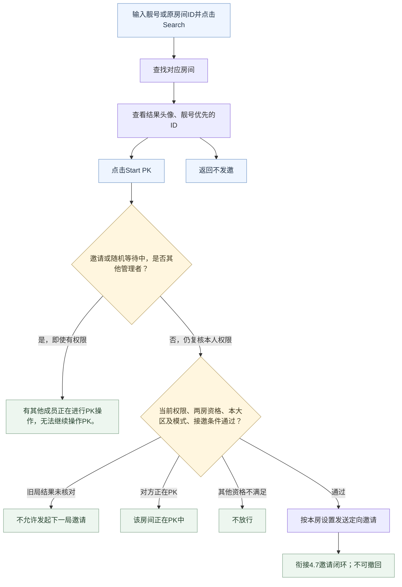

发起后的接受、拒绝、到期及3秒准备分支见4.7.5；发起冷却与并发规则见4.3.4。

#### 4.3.6 状态与异常

靓号与原房间ID均可查房，展示遵循靓号优先。已发邀请后再次查看本页，状态应与当前邀请对应；等待期间只原发起者可在当前权限范围内操作，不能借返回撤回邀请，3秒准备不可主动取消。按钮状态见4.7。

### 4.4 随机匹配中

#### 4.4.1 页面定位与前置条件


- 从选择对手页点击“Random Match”进入，匹配等待内容叠加在当前房间画面上。

- 本页可见匹配角色形象、等待说明和“Cancel Matching”，不另造一张接邀页面。

- 随机双方都须主动发起匹配入池；接收邀请开关与随机候选无关。当前房主不会变更。

- 匹配等待期间只允许原匹配发起者本人执行本次PK操作，且本人仍须具备当前PK权限；其他房主或有权管理员不得代操作。

#### 4.4.2 页面展示与字段

| 内容 | 来源与含义 | 业务边界 |
|---|---|---|
| 匹配形象 | 等待区卡通形象 | 表达正在匹配，不表示已经选中具体房间 |
| 匹配说明 | 预计匹配等待时间 | 预估等待默认60秒、全程匹配等待上限60秒 |
| Cancel Matching | 随机等待中的取消操作 | 只允许原匹配发起者且仍有当前PK权限时取消尚未命中的等待；不用于撤回定向邀请或取消准备 |
| 发起者与当前权限 | 本次主动发起匹配的用户及其当前PK权限 | 用于操作校验，不要求新增页面字段；其他有权管理者也不得代操作 |
| 匹配人数依据 | 双方各自发起匹配时的在麦人数 | 在满足时长条件的候选中，按人数差最小优先 |
| 房间背景 | 当前房间既有麦位、公屏及工具区 | 沿用既有房间能力 |

当前匹配依据是设置时长和在麦人数差，不按在线人数差或综合实力排序。

#### 4.4.3 用户交互

| 用户操作 | 页面反馈/去向 |
|---|---|
| 从选择对手页点击“Random Match” | 衔接当前房间画面上的匹配等待区，准入结果按4.4.4处理 |
| 检索全部候选房间后无同长候选 | 展示4.5异时长征询，不另设等待阈值，不显示为已选中对手 |
| 原发起者在4.5点击“继续匹配”，且仍有当前PK权限 | 扩大本方候选范围，继续寻找候选；不要求双方另行同意，不表示已命中或开始计分 |
| 原发起者尚有当前PK权限、且未命中时点击“Cancel Matching” | 取消本次匹配等待；与命中确实同时发生时随机选择一方结果唯一生效，非同刻按已生效状态处理 |
| 等待期间非发起者尝试取消、继续匹配或发起其他PK操作 | 不执行，提示“有其他成员正在进行PK操作，无法继续操作PK。”；其他房主或有权管理员也不能代操作 |
| 在4.5取消或10秒未响应到期 | 退出本次匹配，不继续同长等待；全程60秒上限不因弹窗延长 |
| 匹配命中 | 直接进入3秒开局准备，不需要再点“接受邀请”；准备不提供主动取消 |

#### 4.4.4 服务端核心逻辑

- 进入匹配前核对当前发起权限、PK黑名单、房间资格及占用，适用3.1、3.2。

**业务处理规则**

1. 随机候选双方均须主动发起匹配入池，排除正在PK中的房间，优先匹配PK设置时长相同的候选。接收邀请总开关及推荐来源偏好与随机候选无关，不用接邀开关代替主动入池意愿。
2. 双方在麦人数分别读取各自发起匹配时的人数；在满足匹配时长条件的候选中，优先选择与本房在麦人数差最小的房间。不替换为在线人数或后续实时人数。
3. 检索全部候选房间后没有相同时长候选时展示4.5提示，不另设等待阈值；本方未点击继续前不得直接扩大本方异时长候选范围。提示显示期间新增同长候选不额外提示。
4. 原匹配发起者仍有当前PK权限并点击“继续匹配”后，扩大本方候选范围，允许匹配异时长候选；不要求双方额外同意，不替对方自动点击继续，也不让未主动入池的房间被动参与。命中后本场取双方设置中较长的时长。
5. 本场取长不修改双方房间长期时长设置，也不扩展到定向邀请。
6. 随机命中后直接衔接3秒开局准备，不再等待对方操作一次“接受邀请”。
7. 进入准备后不可主动取消PK；3秒动画播完自动开赛，无需双方就绪或确认，播完前不计本场PK积分，详见4.9。
8. 取消等待跟随PK权限，但同时限定为原匹配发起者本人；即使另一操作者是房主或有权管理员，也不能代操作。匹配等待倒计时期间，非发起者不得发起PK或执行本次PK操作，统一提示“有其他成员正在进行PK操作，无法继续操作PK。”；本人仍须当前权限。该同一人限制明确适用于等待期间，不扩写为整场永久锁定或新的接管机制。
9. 预估等待默认60秒，全程匹配等待上限60秒。4.5弹窗10秒未响应自动退出本次匹配；弹窗不得延长或重置全程60秒上限。全程到时不再继续本次匹配。
10. 断线后，到发起匹配者的房间心跳结束时自动取消匹配请求；自动取消生效前系统已匹配成功的，正常进入PK模式、按既有链路进入3秒准备，不回退成取消。确实同刻的竞争随机选择一方结果唯一生效，非同刻按已生效状态处理。
11. 所选时长档位被服务端移除时，后续发起匹配采用新的默认档位。成局后PK跟随房间，不因管理员身份或权限变更终止。

**状态变化与异常处理规则**

| 场景 | 处理口径 |
|---|---|
| 尚在匹配等待 | 仅原匹配发起者且仍有当前PK权限时可取消；其他有权房主/管理员不得代操作，触发限制提示“有其他成员正在进行PK操作，无法继续操作PK。” |
| 已命中并进入3秒准备 | 不提供主动取消；旧等待按钮不能转为取消新局准备的入口 |
| 取消与命中竞争 | 非同刻按已生效状态：取消先有效则不成局，命中先有效则进入不可主动取消的准备；确实同刻随机选择一方结果唯一生效 |
| 等待中权限撤销、名单或房间资格变化 | 本人后续操作复核当前权限及资格；撤权本人不得继续，其他管理者不得代操作，MVP不额外设计撤权接管或通知。 |
| 等待到达全程60秒上限 | 不继续本次匹配；不因弹窗另加10秒 |
| 断线及房间心跳结束 | 到发起匹配者房间心跳结束时自动取消；自动取消生效前已匹配成功则正常进入PK模式，不回退取消 |
| 心跳结束与命中精确同刻 | 精确同刻竞争随机选择一方结果唯一生效，非同刻按已生效状态；自动取消前已匹配成功则正常进入PK模式 |
| 进入准备后一方未就绪 | 3秒动画播完自动开赛，不等待双方就绪或确认，不按未就绪设准备超时失败 |

#### 4.4.5 业务流程

**准入与候选范围**

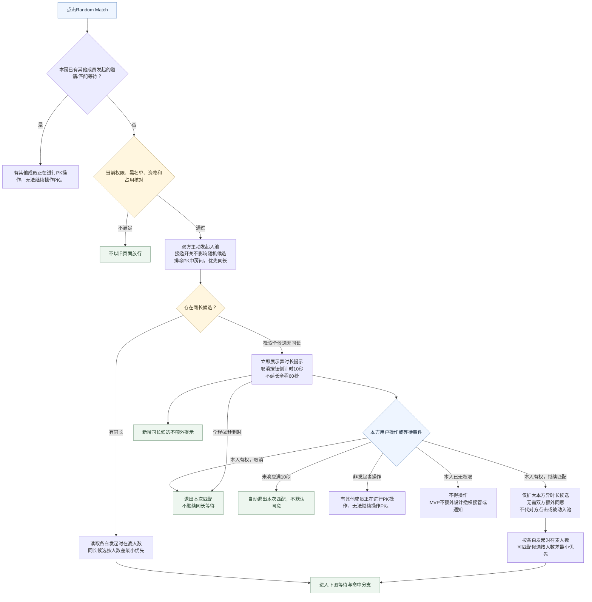

**等待、取消与命中准备**

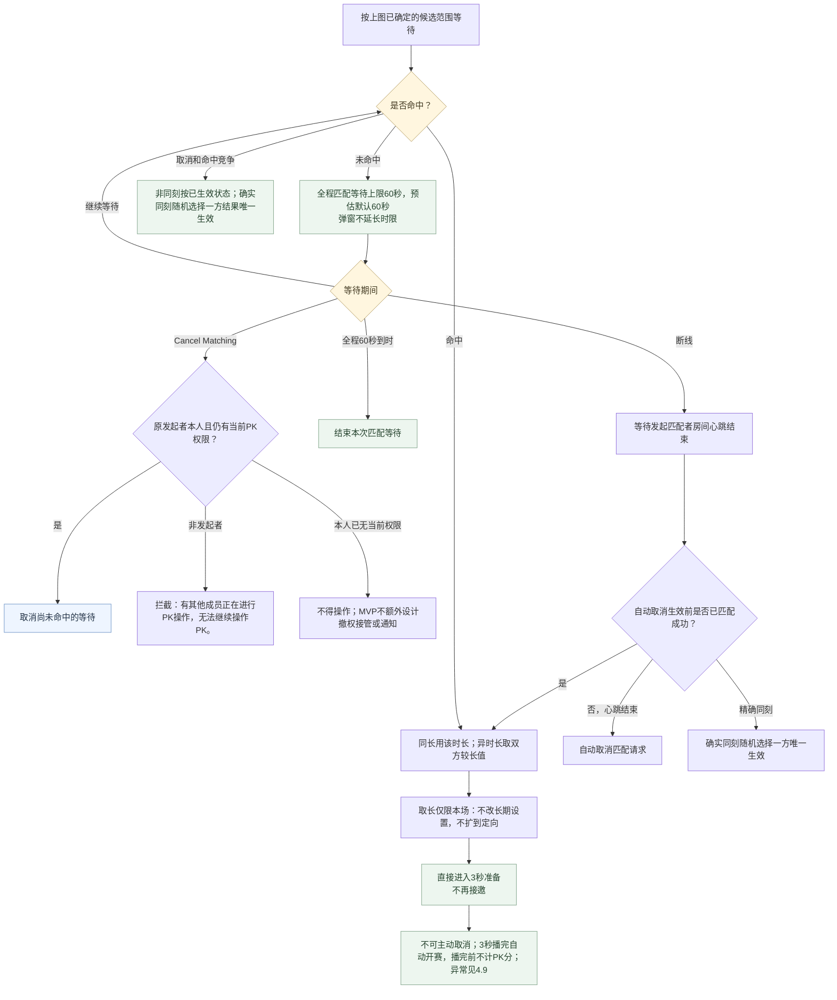

#### 4.4.6 状态与异常

等待中可见Cancel Matching，但仅原匹配发起者且仍有当前PK权限时可操作；其他管理者也不能代操作。已命中进入3秒准备后不提供主动取消。预估默认60秒、全程上限60秒；弹窗不延长时限。断线到发起者房间心跳结束自动取消，自动取消前已匹配成功正常进入PK模式；同刻竞争按随机选择一方结果唯一生效处理。

### 4.5 无相同时长的匹配提示

#### 4.5.1 页面定位与前置条件

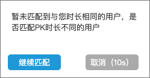

- 在随机匹配过程中，检索全部候选房间后无与本房设置时长相同的候选时，征询是否扩大本方异时长候选范围；不另设等待阈值。

- 本弹窗是扩大随机候选范围的确认，不是已匹配对手的接邀确认。

- 不在定向推荐、ID搜索或战绩定向再邀中直接复用本规则。

- 同长匹配及双方各自发起时在麦人数差最小优先见4.4；异时长取长仅用于本场。弹窗未响应10秒自动退出本次匹配，全程匹配上限60秒不因弹窗延长。

- 匹配等待期间仅原匹配发起者本人且仍有当前PK权限时可操作；其他有权房主/管理员也不得代选。本限制不扩为整场永久锁。

#### 4.5.2 页面展示与字段

| 内容 | 文案或展示 | 含义 |
|---|---|---|
| 说明 | 暂未匹配到与您时长相同的用户，是否匹配PK时长不同的用户 | 说明当前同长候选不足，并征询是否放开异时长 |
| 主要操作 | 继续匹配 | 仅扩大本方异时长候选范围，再继续寻找已主动入池的候选；不要求双方额外同意，不替对方点击继续 |
| 次要操作 | 取消，未响应时增加10秒倒计时 | 点击即退出本次匹配；未响应到10秒自动退出本次匹配，不继续同长等待、不默认同意异时长 |
| 全程时限 | 本次随机匹配全程上限60秒 | 弹窗10秒不延长或重置全程时限 |

#### 4.5.3 用户交互

| 用户操作 | 页面反馈/去向 |
|---|---|
| 原发起者仍有当前PK权限时点击“继续匹配” | 扩大本方候选范围并继续等待；不要求双方额外同意，不表示匹配成功或开始计分 |
| 原发起者仍有当前PK权限时点击“取消” | 退出本次匹配，不继续同长等待 |
| 弹窗显示但未操作 | 取消按钮显示10秒倒计时；未响应到期自动退出本次匹配，不默认同意；全程60秒不被延长 |
| 非发起者尝试继续、取消或发起PK | 不执行，提示“有其他成员正在进行PK操作，无法继续操作PK。”；即使有当前PK权限也不能代操作 |
| 提示显示期间新增同长候选 | 不额外提示 |

#### 4.5.4 服务端核心逻辑

**业务处理规则**

1. 检索全部候选房间无相同时长时展示提示，不额外设置等待阈值。未点击“继续匹配”前，不因等待时间长、弹窗超时或未响应而默认扩大本方异时长范围。
2. 原匹配发起者且仍有当前PK权限时点击“继续匹配”，才扩大本方异时长候选范围；不要求双方额外同意，不替对方自动点击继续，也不让对方被动入池。不代表此时已经匹配成功或开始计分。
3. 放开候选后，双方仍须各自主动发起匹配入池，接邀开关与随机候选无关；按4.4条件及双方各自发起时在麦人数差最小优先，不改为在线人数或实力评分。
4. 匹配命中后，本场PK时长取双方设置时长中较长的一方。
5. 本场时长用于后续开局和本场倒计时，不改写任一方房间长期设置。
6. 命中后直接进入3秒准备，不额外生成一次接邀操作；准备不可主动取消。
7. 双方当前PK资格、权限及主动入池事实仍须复核；本方点击不代替对方主动入池，但不要求双方再各点一次异时长同意。等待期间所有本次PK操作只由原发起者本人执行且本人仍须当前PK权限；非发起者即使是有权房主/管理员也不得代操作，提示“有其他成员正在进行PK操作，无法继续操作PK。”。房主不会变更，不新增等待接管方案。
8. 点击取消即退出本次匹配。弹窗未响应时取消按钮增加10秒倒计时，到期自动退出本次匹配；全程匹配上限60秒，不因弹窗延长或重置。确实同刻竞争随机选择一方结果唯一生效，非同刻按已生效状态，不新增通知或退出后的页面跳转规则。
9. 提示显示期间新增同长候选不额外提示；

**状态变化与异常处理规则**

| 场景 | 处理边界 |
|---|---|
| 点击取消 | 退出本次匹配，不继续同长等待；与命中确实同刻时随机选择一方结果唯一生效，非同刻按已生效状态处理 |
| 弹窗显示但未操作 | 取消按钮10秒倒计时，未响应到期自动退出本次匹配，不默认同意；不因弹窗延长全程60秒 |
| 显示期间出现同长候选 | 不额外提示 |
| 点击继续后再次无候选 | 仍受全程60秒上限限制，不重新起算 |
| 同时发生命中、取消或权限变化 | 与随机等待及准备状态共同判定；非同刻按已生效状态，确实同刻随机选择一方结果唯一生效；撤权本人不得继续操作 |

本弹窗取消与等待页Cancel Matching均退出本次尚未命中的匹配，但不改变邀请不可撤回或3秒准备不可主动取消。异时长只需本方继续扩大范围，不要求双方额外同意；对方仍须主动入池，不自动代点对方继续。

#### 4.5.5 业务流程

详见4.4.5随机匹配详细流程：检索全部候选无同长 → 展示本弹窗和取消按钮10秒倒计时 → 原发起者且仍有当前PK权限时点击“继续匹配”才扩大本方候选范围，不要求双方额外同意；点击“取消”或未响应满10秒均退出本次匹配，不继续同长等待 → 有效命中后本场取双方较长时长、直接3秒准备。全程匹配上限60秒，不因弹窗延长。非发起者操作拦截并显示指定提示；提示期间新增同长候选不额外提示，精确同刻竞争随机选择一方结果唯一生效，非同刻按已生效状态。

#### 4.5.6 状态与异常

未响应10秒自动退出本次匹配；点击取消也退出，不继续同长等待，不默认异时长授权。全程60秒不被弹窗延长。提示期间新增同长候选不额外提示；确实同刻竞争随机选择一方结果唯一生效，非同刻按已生效状态。

### 4.6 PK设置

#### 4.6.1 页面定位与前置条件

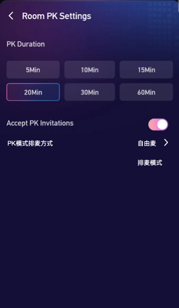

- 从选择对手页设置入口进入，标题为“Room PK Settings”，顶部有返回箭头。

- 本页新增“PK模式排麦方式”，可选“自由麦”“排麦模式”，记住上一次设置，未设置过默认排麦模式。

#### 4.6.2 页面展示与字段

| 设置 | 来源及含义 | 确定边界 |
|---|---|---|
| PK Duration | 房间PK时长 | 可用档位按服务端实时配置 |
| 默认时长 | 服务端控制，默认20分钟 | 读取失败不作为无保存选择处理 |
| 可用PK时长 | 服务端配置的可用时长 | 配置更新实时生效；旧选择不符合新配置时自动关闭设置弹窗并toast“时长选项已更新，请重新设置。”；后续发起邀请或匹配采用新的默认档位 |
| PK模式排麦方式 | 可选“自由麦”“排麦模式”；记住上一次设置的排麦方式，未设置过默认选择“排麦模式” | 复用既有两种排麦逻辑 |
| 自由麦 | 用户无需房主审批即可上空缺麦位 | 无需为PK新增房主审批步骤；空缺麦位及其他既有上麦规则沿用原能力 |
| 排麦模式 | 用户需要房主或管理员审批后分配到空缺麦位 | 复用已有审批及空缺麦位分配逻辑，排队列表与选麦操作见4.10 |
| Accept PK Invitations | 接受PK邀请总开关 | 邀请偏好不等于PK操作授权 |
| 推荐来源偏好 | 接受推荐PK邀请的偏好设置 | 不影响随机候选范围 |

邀请偏好不等于PK操作授权；打开接邀不能让观众或未授权管理员执行比赛管理。接收邀请开关及来源偏好与随机候选无关；随机双方仍须主动发起入池。

#### 4.6.3 用户交互

| 用户操作 | 页面反馈/去向 |
|---|---|
| 从选择对手页进入设置 | 展示“Room PK Settings”、当前PK时长、邀请偏好及PK模式排麦方式；排麦方式回显上一次设置，未设置过默认选排麦模式 |
| 选择PK模式排麦方式 | 可在“自由麦”“排麦模式”中选择；记住上一次设置 |
| 选择PK时长 | 用于后续新定向邀请的发送时长及随机匹配时长条件 |
| 修改接邀总开关或推荐来源偏好 | 设置接受PK邀请的偏好，不改变随机双方主动入池规则 |
| 服务端配置更新后，旧选择不符合新配置 | 自动关闭设置弹窗页面并toast“时长选项已更新，请重新设置。”；后续发起邀请或匹配采用新的默认档位 |
| 本房匹配/邀请等待倒计时期间，非发起者尝试操作PK | 不执行，提示“有其他成员正在进行PK操作，无法继续操作PK。”；有权管理者也不得代操作 |

#### 4.6.4 服务端核心逻辑

- 本页设置房间PK时长、接收邀请偏好及PK模式排麦方式，不作为管理员授权或黑名单管理页面。

- 修改资格按当前权限判断，不能仅凭入口可见默认允许修改。房主不会变更。

- 在本房已发邀请或匹配的等待倒计时期间，本次PK发起和操作只能由原发起者本人进行，且本人仍须当前对应权限；非发起者即使是有权房主/管理员也不得代操作，提示“有其他成员正在进行PK操作，无法继续操作PK。”。此限制仅明确等待期间，不扩写为整场永久锁或新的接管机制。

**业务处理规则**

1. 用户选择PK时长，用于后续新定向邀请的发送时长和随机匹配时长条件。
2. 随机双方主动入池，接邀开关及来源偏好与随机候选无关；优先同长。检索全部候选无同长后提示，本方原发起者点击继续才扩大本方异时长范围，不要求双方额外同意、不替对方点击继续；命中后本场取双方较长设置，详见4.4、4.5。
3. 异时长命中只改变本场时长，不回写房间长期设置。
4. 定向邀请按本房设置发送，不自动套用异时长随机取长。
5. 不接受PK邀请的房间从推荐候选过滤；发起提交时再次核对，不能仅凭旧列表。
6. 修改接邀偏好不得被用作撤回本房已发定向邀请，发出后不可撤回。
7. 默认时长20分钟，可用时长由服务端配置，配置更新实时生效。旧选择不符合新配置时自动关闭设置弹窗页面，并toast“时长选项已更新，请重新设置。”；后续发起邀请或匹配采用新的默认档位。

**PK模式排麦方式**

- 仅有“自由麦”“排麦模式”两项，记住上一次设置的排麦方式；未设置过时默认选择“排麦模式”，再次进入设置页回显上一次设置。读取失败不等于未设置过，不据默认值覆盖既有设置。
- 自由麦：用户无需房主审批即可上空缺麦位。
- 排麦模式：需要房主或管理员审批后分配到空缺麦位。两种模式均复用已有排麦逻辑；排队列表及选麦操作见4.10。
- 排麦方式决定用户上麦方式，不替代4.10保留的房主、管理员对本方麦位的锁麦、闭麦、将用户下麦、邀请用户上麦能力；房主和管理员按4.10处理本方排麦申请。

**状态变化与异常处理规则**

| 场景 | 本模块处理边界 |
|---|---|
| 首次打开或没有已保存选择 | 服务端默认时长20分钟；不把读取失败直接当作无保存选择 |
| 服务端调整可用档位 | 配置更新实时生效；旧选择不符合新配置时自动关闭设置弹窗页面并toast“时长选项已更新，请重新设置。”；后续发起邀请或匹配采用新的默认档位 |
| 排麦方式未设置过 | 默认选择排麦模式；不把读取失败当作未设置过 |
| 已设置过排麦方式后重新进入 | 回显上一次设置的排麦方式，不因默认值调整而覆盖已有选择 |
| 权限在页面打开后被收回 | 后续修改须复核当前权限，旧页面不保留已撤销授权 |
| 关闭接邀时已有邀请 | 不能视为主动撤回已发邀请 |
| 多名管理者或多端同时修改 | 等待期间先执行原发起者本人限制；其余允许修改场景非同刻按已生效修改处理，确实同时的修改竞争随机选择一方结果唯一生效 |

#### 4.6.5 业务流程

设置页展示服务端可用时长，默认20分钟 → 服务端配置更新实时生效 → 旧选择不符合新配置时自动关闭设置弹窗页面，并toast“时长选项已更新，请重新设置。”；后续发起邀请或匹配采用新的默认档位。

后续链路详见4.3.5、4.4.5及4.7.5：定向发送读取本房时长；随机双方主动入池且不受接邀开关影响，优先同长，检索全部候选无同长才提示；本方继续后扩大本方异时长范围，不要求双方额外同意，命中取长仅本场、不回写长期设置。匹配全程上限60秒，弹窗未响应10秒退出且不延长全程；等待期间先复核是否原发起者本人及当前权限，非发起者拦截并提示指定文案。

**排麦方式设置与上麦衔接**

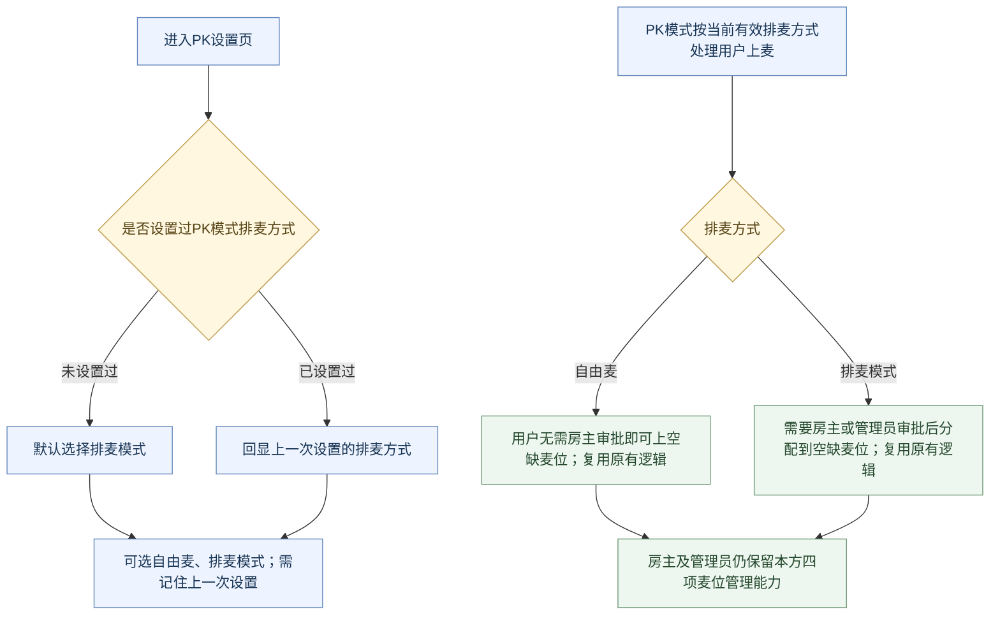

上麦方式不改变4.10初始12麦布局及既有麦位管理能力。

#### 4.6.6 状态与异常

默认时长20分钟。配置更新实时生效，旧选择不符合新配置时自动关闭设置弹窗并toast“时长选项已更新，请重新设置。”；后续发起邀请或匹配采用新的默认档位。

### 4.7 已发送邀请

#### 4.7.1 页面定位与前置条件

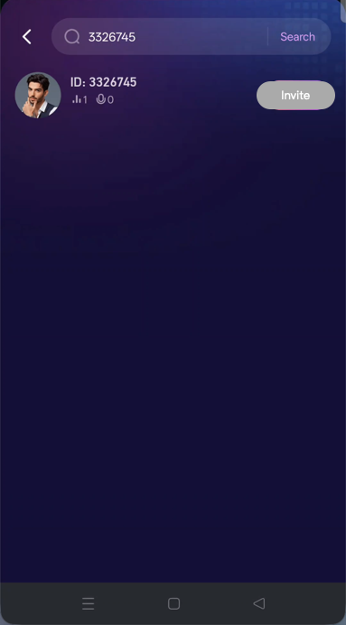

- 推荐或ID搜索对指定房间成功发送邀请后，进入待对方响应状态；战绩和结算再邀沿对应入口规则衔接。

- 定向邀请发出后不可撤回，不因离开搜索页或关闭展示而撤回。

#### 4.7.2 页面展示与字段

| 内容 | 来源及含义 | 本模块边界 |
|---|---|---|
| 搜索栏、返回、Search | 搜索结果页既有内容 | 不表示重新发出另一条邀请 |
| 对手头像、ID | 本条定向邀请对应的目标房间 | 房主有靓号优先显示靓号ID，无靓号沿原房间ID |
| 两组图标数字 | 对手资料行 | 左侧房间热度值、右侧当前麦上人数 |
| 已发送邀请 | 邀请待响应状态 | 表示邀请已发出、尚待响应；不是开始PK |

#### 4.7.3 用户交互

| 用户操作 | 页面反馈/去向 |
|---|---|
| 从推荐或ID搜索点击发起并发送成功 | 进入“已发送邀请”待响应状态；战绩和结算再邀沿对应入口衔接 |
| 返回、关闭展示或修改接邀设置 | 不撤回已发邀请；不提供撤回操作 |
| 等待对方有效接受 | 双方进入不可主动取消的3秒准备，随后按开局规则处理 |
| 等待期间对方拒绝或邀请到期 | 拒绝/到期时结束本次邀请并释放本次等待占用；被拒后立即可邀另一房，不等于比赛失败 |
| 本房其他成员在等待期间发起或操作PK | 拦截，不改变当前邀请，提示“有其他成员正在进行PK操作，无法继续操作PK。” |

#### 4.7.4 服务端核心逻辑

**业务处理规则**

1. 实际发送前核对当前发起权限、PK黑名单、两房资格、接邀偏好及状态；旧局核对未完成不得发下一局邀请。
2. 普通定向邀请按本房设置PK时长，服务端默认及可用时长配置见4.6。
3. 发起后30秒内不允许向其他人发起PK；该邀请被拒绝后可立即邀请另一房，不锁剩余30秒。冷却与邀请有效期分开：本次邀请从发起起总计30秒，30秒内未被有效接受则废弃。
4. 已发邀请等待对方接受、拒绝或邀请失效；不提供撤回操作，也不借返回、关闭或修改接邀设置实现撤回。
5. 对方有效接受并复核通过后，双方进入不可主动取消的3秒开局准备，随后按开局规则处理。
6. 对方拒绝或发起本次邀请后满30秒仍未被有效接受，本次邀请结束并释放本次等待占用，不生成比赛失败结果。
7. 结算期向原对手再邀时，退出旧结算展示不使该邀请失效，仍按原有效期等待并保留邀请占用，详见3.2及4.18。
8. 已发邀请等待倒计时期间，只能由原发起者本人操作，其他成员不得通过推荐、搜索、随机、战绩或结算再邀另发起，提示“有其他成员正在进行PK操作，无法继续操作PK。”；本人仍不可撤回。非同刻竞争按已生效状态处理，确实同刻随机选择一方结果唯一生效，不重复创建有效链路；接收房首次接受/拒绝另以最先操作者为准。
9. 旧局庆祝尚未播完时，其他房间不能向该房间发起PK；不据此扩写为庆祝结束后自动接受或自动放开所有资格。

**状态变化与异常处理规则**

| 场景 | 确定约束 |
|---|---|
| 对方尚未响应 | 不算开局，无撤回入口；从发起本次邀请起总计30秒，期内未被有效接受则废弃并释放本次等待占用 |
| 对方收到邀请后变忙或失去资格 | 接受时再复核，不凭已发状态直接准备 |
| 身份、授权或房间状态变化 | 撤权本人不得继续相关操作，其他管理者不能代操作；MVP不额外设计撤权接管或通知。成局后PK跟随房间，不因管理员身份或权限变化终止 |
| 对方正处于PK中 | 发起拦截提示“该房间正在PK中”，不将其当作有效发送 |
| 旧结算展示已结束但原再邀仍有效 | 不因恢复普通布局而改为可邀第三方；保留既有再邀占用 |

#### 4.7.5 业务流程

**定向发送与等待**

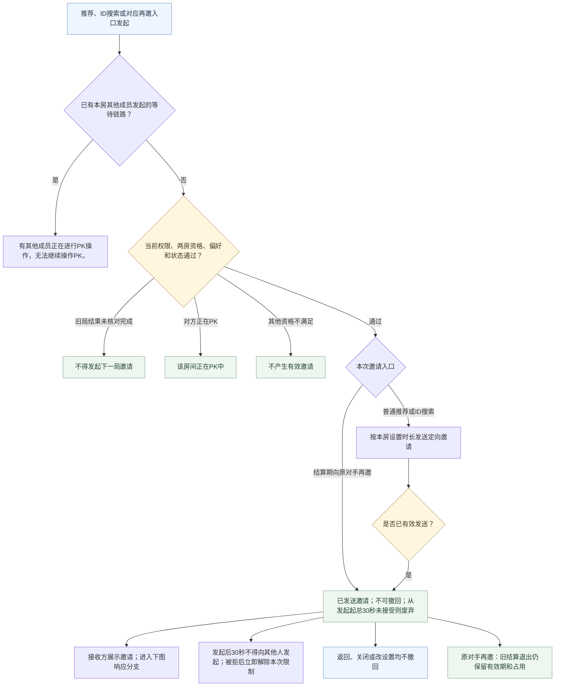

**接收响应与准备闭环**

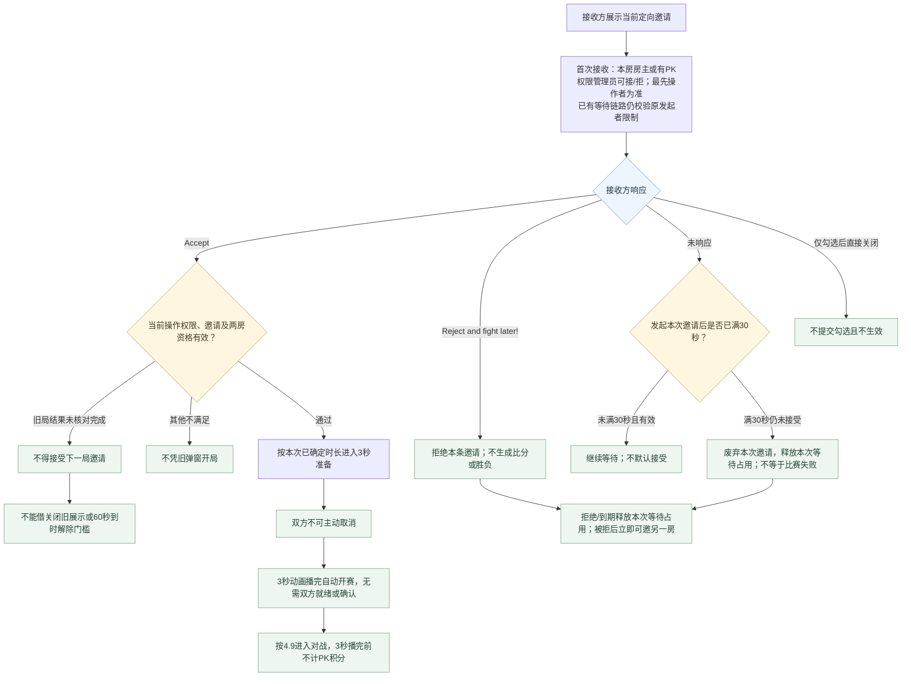

结算期原对手再邀同样执行发起、接受双时点旧局核对；新局进入准备后，旧结算到时不能取消新局。

#### 4.7.6 状态与异常

区分未有效发送与已有效发送。已发送只表示等待响应，不算开局。邀请从发起起总计30秒，未被有效接受即废弃；拒绝/到期释放本次等待占用，被拒后立即可邀另一房。

### 4.8 收到PK邀请

#### 4.8.1 页面定位与前置条件

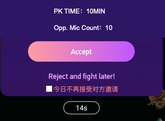

- 接收方房间收到定向PK邀请时展示接邀弹窗；随机匹配命中不经过本弹窗。

#### 4.8.2 页面展示与字段

本页凡展示双方房间ID，均按3.1：房主有靓号优先显示房主靓号ID，无靓号沿用原房间ID。

| 内容 | 来源与含义 | 边界 |
|---|---|---|
| 邀请者头像及标识 | 发起邀请的房间资料 | — |
| 邀请说明 | Someone invited you to a 10-minute Room PK. Accept? | 实际读取本条邀请时长 |
| PK TIME | PK时长 | 展示邀请所用PK时长 |
| Opp. Mic Count | 对方在麦人数信息 | 表达邀请方在麦人数，不替换为房间在线人数；没有数值不能当作0 |
| Accept | 接受该条邀请 | 接受前复核通过才转入准备，不以点击本身保证开局 |
| Reject and fight later! | 拒绝该条邀请 | 不生成本场PK；拒绝后结束本次邀请并释放本次等待占用 |
| 今日不再接受对方邀请 | 邀请偏好勾选项 | 限定对象为对方邀请，不等于总开关、全平台免打扰或PK黑名单 |
| 剩余倒计时 | 当前邀请剩余响应时间 | 从发起本次邀请起总计30秒，期内未有效接受则废弃 |

#### 4.8.3 用户交互

| 用户操作 | 页面反馈/去向 |
|---|---|
| 点击“Accept” | 复核通过后立即进入不可主动取消的3秒准备，3秒动画播完自动开赛，无需双方就绪或确认；点击仍须复核邀请和资格 |
| 点击“Reject and fight later!” | 拒绝本条邀请，不产生PK比分或胜负，释放本次等待占用，发起房立即可邀另一房 |
| 勾选“今日不再接受对方邀请” | 仅勾选后直接关闭弹窗不提交且不生效 |
| 未响应、切后台或重新进入 | 不默认接受 |

#### 4.8.4 服务端核心逻辑

首次收到邀请时，接收房房主及具有当前PK权限的管理员可接受或拒绝，以最先操作者为准，不由发起房操作者身份指定接收人。本房若已有邀请/随机匹配等待链路，仍须遵守原发起者限制，非本人提示“有其他成员正在进行PK操作，无法继续操作PK。”，不能借新弹窗绕过已有占用。

- 首次接收房房主及有PK权限管理员可接受/拒绝；执行时仍检查当前权限，观众无管理操作。修改偏好等其他授权不随本次接/拒确认一并放开。

**业务处理规则**

1. 点击接受时，核对操作者当前权限、邀请当前有效状态、双方PK黑名单及房间资格，不沿用弹窗打开时的判断。
2. 旧局结果尚未核对完成时，不允许接受下一局邀请；旧展示关闭、60秒到时均不能解除限制。
3. 定向邀请按邀请携带时长处理，不套随机异时长取长。
4. 有效接受后立即进入不可主动取消的3秒准备；3秒动画播完自动开赛，无需双方就绪或确认，播完前不计本场PK积分。
5. 点击拒绝结束本条邀请并释放本次等待占用，不产生PK比分或胜负；发起房可立即邀请另一房，不锁剩余30秒。
6. 仅勾选“今日不再接受对方邀请”后直接关闭弹窗，不提交该勾选且不生效；不自动关闭弹窗。
7. 邀请从发起本次邀请起总计30秒，期内未被有效接受即废弃并释放本次等待占用；未响应不默认接受，重进不重启30秒。

**状态变化与异常处理规则**

| 场景 | 本模块处理边界 |
|---|---|
| 重复点击或旧弹窗再次响应 | 当前权限及邀请状态共同复核；首次接收房接/拒以最先操作者为准，只生效一次，旧弹窗不能覆盖已生效响应 |
| 接受与拒绝/到期同时发生 | 首次接收房多人接/拒优先按最先操作者处理；接受与到期等其他竞争非同刻按已生效状态，确实同刻随机选择一方结果唯一生效，不重复成局 |
| 发起方变忙、关房或失去资格 | 不凭旧弹窗强行开局；撤权本人不得继续，MVP不额外设计撤权接管或通知，成局后不因管理员身份/权限变化终止 |
| 接收方不在线、切后台或重新进入 | 不默认接受；恢复时读取当前邀请，过期不自动重开响应期 |
| 结算期原对手再邀 | 旧结果核对完成才可接受；有效接受转新局准备，旧场到时不能取消新局 |
| 已勾选后直接关闭 | 不提交勾选且不生效 |

#### 4.8.5 业务流程

详见4.7.5“接收响应与准备闭环”：本模块对应展示邀请、Accept、Reject and fight later!、未响应/到期及仅勾选“今日不再接受对方邀请”后直接关闭分支。接受时再次执行旧局核对门槛；随机命中不走本弹窗。

#### 4.8.6 状态与异常

区分待响应、有效接受后的准备、拒绝及到期。邀请从本次发起起总计30秒，未有效接受则废弃并释放本次等待占用。Opp. Mic Count没有数值不能当作0。切后台或重进不默认接受。

### 4.9 开局3秒倒计时

#### 4.9.1 页面定位与前置条件

定向邀请被有效接受、随机匹配有效命中，或结算期间向原对手再邀被有效接受后，进入3秒开局准备。随机命中直接进入准备，不再增加一次接邀。

- 进入资格、当前权限及占用关系见3.1、3.2；旧局结果未核对完成时禁止发起/接受下一局邀请。

#### 4.9.2 页面展示与字段

本页凡展示双方房间ID，均按3.1：房主有靓号优先显示房主靓号ID，无靓号沿用原房间ID。


本页是开局动画状态，不是比赛结果页。

| 内容 | 来源 | 展示要求 |
|---|---|---|
| 中央PK标识 | 本次开局动画 | 位于房间主体区域，表达即将进入PK |
| 倒计时数字 | 本次3秒准备进度 | 按3秒倒计时播放 |
| 双方对抗形象 | PK开局素材 | 红蓝形象作为开局表现，不代表已有积分或胜负 |
| 房间底层 | 当前房间页面 | 保留房间上下文；遮挡中的麦位与昵称不另补新字段 |

本页不新增计分起点、就绪状态或失败按钮。

- 正式进入进行中后，按4.10的双边布局、当前比分与麦位展示；动画播放完成本身不等于送礼成功或新增积分。

#### 4.9.3 用户交互

本页自动展示，不提供主动操作；进入入口沿用定向邀请、随机匹配与结算期再邀模块。关闭展示、切后台或跳房的占用后效见4.9.4。

- 3秒倒计时期间不可主动取消PK，房主、管理员均不例外。

- 本页不增加“取消”“跳过”“重新开始”等操作。

#### 4.9.4 服务端核心逻辑

- 关闭展示、切后台或跳房不能视为取消准备，也不能自动解除两房占用。

- 有效进入准备后自动播放3秒PK倒计时动画。双方属于同一待开局场次，不能各自创建一场。

- 有效接受或有效命中后，按既定流程播放3秒动画；播完自动开赛，无需双方就绪、无需再次确认，不设置可靠就绪门槛或未就绪超时失败分支。单方发出邀请仍只是待响应，不直接进入准备或开赛。

- 3秒动画播完前送礼不计本场PK积分，播完后按本场规则计分；不将普通礼物消费失败与是否计PK分混为一谈。

- 结算期再邀有效接受后立即进入本页，不必等待旧局60秒展示结束；旧局的积分、支持榜与收礼MVP不得作为新局累计起点。

- 已进入新局准备后，旧局“立即结束”及旧60秒到时不再作用于本次准备。

- 同房多人或多端重复触发：不能生成多个开局；沿3.2的唯一占用与有效状态处理。
- 非同刻竞争按已生效状态处理，确实同刻随机选择一方结果唯一生效；首次接收房接受/拒绝以最先操作者为准，不用随机规则覆盖。成局后PK跟随房间，不因管理员身份或权限变化终止；该成员后续操作仍须具备当前权限。

- 原对手再邀与旧展示退出同时发生：有效接受进入新准备；旧展示退出不能撤回该邀请或结束新场。

#### 4.9.5 业务流程

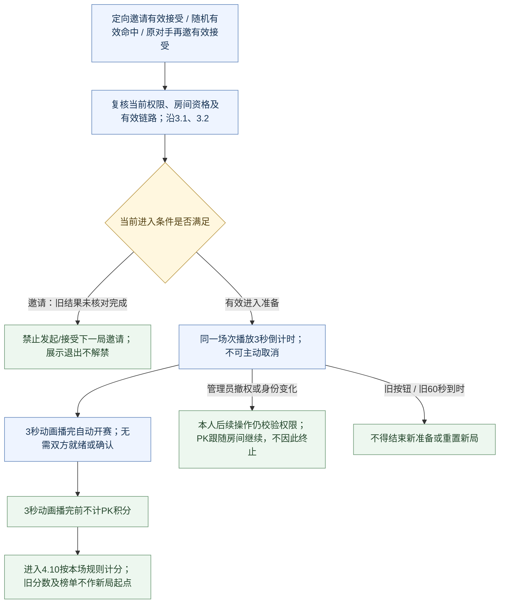

#### 4.9.6 状态与异常

| 场景 | 业务边界 |
|---|---|
| 动画卡顿、声音未播、页面晚到 | 不把表现故障直接判为比赛取消、送礼失败或重新开始3秒 |
| 准备期间断线或一房未就绪 | 不以双方可靠就绪为开赛门槛，3秒播完仍按既定流程自动开赛，不设未就绪超时失败 |
| 准备期间管理员撤权或身份变化 | 成局后PK跟随房间，不因管理员身份或权限变更终止；本人后续操作仍须有当前权限，不开放主动取消。房主不可变更 |
| 重进房或切回前台 | 展示当前实际阶段；不凭旧倒计时帧让进行中的场次重开 |

异常失败与主动取消是不同路径，不能用“准备失败”名义向用户增加取消入口。

### 4.10 进行中：双方互搏

#### 4.10.1 页面定位与前置条件

本模块承接4.9正式开局后的双方对战页；互搏是进行中的增分表现，不是结果状态。

页面以本场设置时长展示剩余时间。

#### 4.10.2 页面展示与字段

本页凡展示双方房间ID，均按3.1：房主有靓号优先显示房主靓号ID，无靓号沿用原房间ID。


正式进入本场PK后展示双方对战区域。双方分数无变化，或2秒内双方均增加分数时，显示双方互搏动画；互搏不表示当前平分，也不表示本场已经判为平局。

| 区域 | 来源 | 展示要求 |
|---|---|---|
| 我方、对方信息 | 本场配对房间及对应成员资料 | 分区展示双方头像、名称与我方/对方标识，不能因观看方切换把分数记错房 |
| 比分条与双方积分 | 本场双方累计PK积分 | 持续展示双方当前分数，计算口径统一见3.3 |
| 比赛倒计时 | 本场确定时长及当前比赛进度 | 双方按统一计时方向展示，有效接受或随机命中后，3秒动画播完自动开赛，无需双方确认就绪；准备期不计PK积分 |
| 双方麦位 | 本场在麦成员与PK前麦序 | 展示主播头像、昵称、麦位编号及本场收礼分数 |
| 支持者头像区 | 各房本场送礼贡献排名 | 双方分别显示送礼分数前三头像；同分先达到者靠前 |
| 收礼MVP标识 | 各房本场收礼分数 | 标记各房本场收礼分数最高用户，不固定为房主、不与送礼榜合并 |
| 首赠提示 | 本局零分提示条件 | 本局PK分数为0时显示“首次赠送礼物+10%”；不与末段加成叠加 |
| 双方互搏形象 | 当前分数变化表现 | 无分数变化或2秒内双方均增分时展示，不改变积分 |

宝箱区域展示双方达到本场目标的进度；任一房可靠先达后双方宝箱进度冻结，但比赛分和另一房A达标继续。当前支持榜前三及收礼MVP是赛中动态展示，A获奖人以赛终榜为准；C期间榜按先达时点独立保留，详见4.13～4.15。

- PK开始后，麦上序号前12名无需下麦，按PK前麦位序号升序入座1～12；每房容量为12个PK麦位，不是全场合计12个。

<span style="color: #ff0000;"><strong>重点备注：进入PK麦位布局后，需保持房主和管理员对本方麦位的管理能力，包括锁麦、闭麦、将用户下麦、邀请用户上麦。</strong></span>

- PK模式强制切换PK房间背景。

- 首次引导按时间进度提示。

- 公屏自动折叠，为PK布局腾出区域；用户主动展开后的结果见4.10.3。

- 中间送礼横幅及幸运礼物中奖动画增加仅PK模式可用的动画开关；操作边界见4.10.3。

#### 4.10.3 用户交互

| 用户动作 | 可见结果 |
|---|---|
| 自由麦模式下用户上麦 | 无需房主审批即可上空缺麦位，复用已有自由麦逻辑 |
| 排麦模式下用户上麦 | 需要房主或管理员审批后分配到空缺麦位，复用已有排麦逻辑 |
| 房主或管理员管理本方麦位 | 保留锁麦、闭麦、将用户下麦、邀请用户上麦的既有能力；操作对象为本方麦位，不扩展至对方麦位 |
| 展开公屏 | 公屏悬浮于PK布局顶部；比赛不暂停、分数不改变 |
| 打开进行中PK操作面板并点击End Early | 按4.22校验后立即提前结束，发起提前结束的一方默认失败并进入结束流程 |
| 使用仅PK模式可用的送礼横幅/幸运礼物中奖动画开关 | 控制对应表现 |

**PK排麦模式**

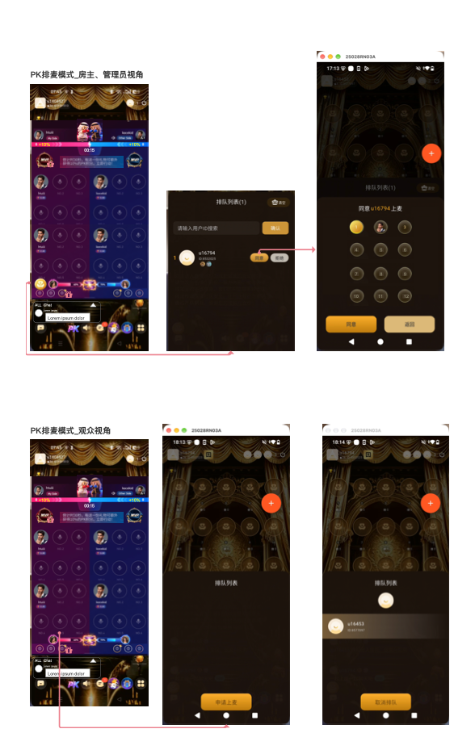

**房主、管理员：排队列表与选麦**

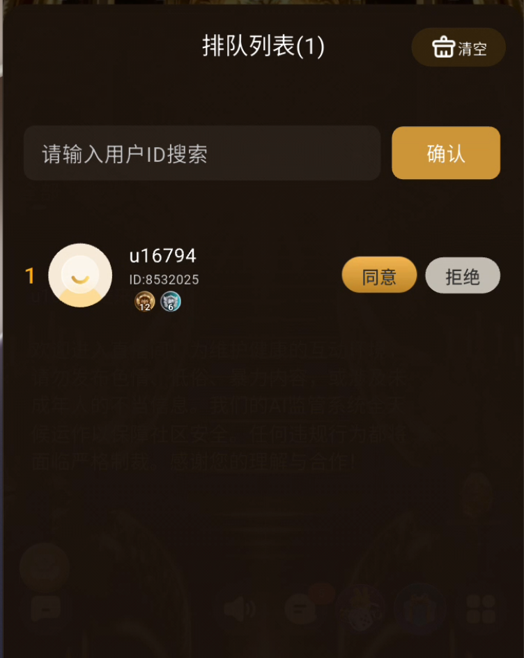

| 操作区域 | 展示与交互 |
|---|---|
| 排队列表 | 展示排队人数、排队用户序号、头像、昵称及ID |
| 按用户ID搜索 | 输入用户ID，点击“确认”搜索 |
| 清空 | 清空排队列表 |
| 拒绝 | 拒绝对应用户的上麦申请 |
| 同意上麦 | 点击用户行“同意”进入选麦界面，展示“同意［用户昵称］上麦”及本方1～12号PK麦位；选择空缺麦位后点击“同意”，将用户分配至对应空缺麦位；点击“返回”返回排队列表 |

**观众：申请上麦与取消排队**

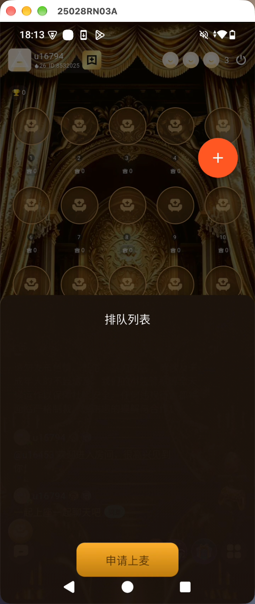

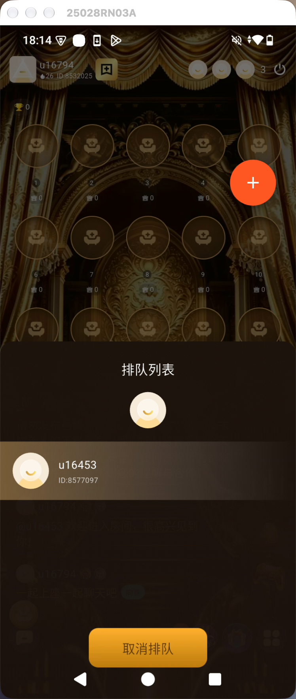

- 用户在排队列表点击“申请上麦”参与排麦；排队中展示用户信息及“取消排队”按钮。
- 用户点击“取消排队”退出排队。
- 排麦申请及审批作用于本方麦位，不改变本场PK流程和计分规则。

送礼、查看榜单沿用既有房间能力，不新增独立PK送礼页。房主/管理员的对方声音总控与观众个人收听操作如下。

- 房主或管理员开启/关闭对方房间声音总控 → 对方房间声音在本房播放/停止在本房播放。

- 本房总控开启后，观众点击对方房间音频，个人静音/恢复 → 仅本人停止/恢复收听，不改变其他观众或另一房声音；总控关闭时不能恢复收听。

#### 4.10.4 服务端核心逻辑

本方麦位管理沿用既有房间能力：进入PK麦位布局不得使房主、管理员的锁麦、闭麦、将用户下麦、邀请用户上麦能力失效；仅作用于本方麦位，不从本条推导对方麦位管理权或新增PK操作授权。

**PK中的上麦方式**

按4.6的PK模式排麦方式复用已有逻辑：自由麦下，用户无需房主审批即可上空缺麦位；排麦模式下，需要房主或管理员审批后分配到空缺麦位。用户主动上麦方式与房主、管理员的本方麦位管理能力分开，不将排麦审批扩展为PK开局前的额外审批，不让已有在麦用户因布局切换重新申请。

**计分链路（沿用3.3）**

| 判断顺序 | 服务端业务规则 |
|---|---|
| 礼物是否成功 | 沿既有消费规则核实有效礼物，动画、音效不作扣费凭证；计分单位为金币 |
| 礼物分类与基础积分 | 非幸运礼物1金币=1PK积分；幸运礼物10金币=1PK积分；CP礼物计入数值同非幸运礼物，1金币=1PK积分。先按分类换算基础积分，再按适用的唯一加成倍率计算，不按返奖或净损耗改算幸运礼物 |
| CP礼物房间归属 | CP礼物允许收礼对象不在本房间，所赠CP礼物的PK积分统一计入送礼方所在房间；不得随外房收礼对象转移，也不得仅因对方不在本房/本房麦位而排除本房积分 |
| 单次赠送 | 选择多人送多个礼物按单次赠送，不按批次内各份跨末30秒拆成不同倍率；不同礼物类型仍分别换算基础积分，不混用一个价值基数 |
| 计分对象 | 麦上用户一定计入；麦下收送礼由服务端控制。CP收礼对象不在本房不作为排除本房积分的条件 |
| 首赠与末段 | 首赠提示为“首次赠送礼物+10%”。末30秒对适用新贡献额外加10%，不加成已有总分；首赠与末段不叠加 |
| 计算同一份积分 | 单次有效赠送PK积分＝本次各有效礼物按分类换算的基础PK积分之和×本次唯一有效倍率；非幸运/CP兑换基数为1、幸运为10；多人多礼物仍算一次赠送，不逐份拆出跨末30秒的倍率。无加成为1，适用10%加成时为1.1；不是1.2或1.21 |
| 分房与分榜累计 | 使用同一份分类换算后的礼物积分，同笔多条消息不重复记分。CP房间总分归送礼方本房，不据此将外房收礼对象自动纳入本房收礼榜。各房送礼前三按贡献排序、同分先达到者靠前；各房收礼最高者为MVP，同分先达到者靠前，不固定房主、不合并两榜；贡献人数不足3人按实际贡献人数展示，不补用户 |
| 计分结束 | 正常到时或有效提前结束停止收分，分数结算完成后按4.18展示结果，不设置正常流程长期核对分支。历史退款不纳入本期处理，不追加追溯改判 |

加成只改变PK分，不增加礼物资产、收礼收益或工资。100金币有效礼物价值：非幸运/CP基础100分、幸运基础10分；适用1.1倍率时分别为110分、11分，CP仍归送礼方本房。

- 麦上用户一定纳入PK计分；麦下收送礼是否计入由服务端控制。CP收礼对象在外房不阻止其PK积分归送礼方本房；上下麦、成员变化不追溯增减已经形成的积分。

- 动画开关只影响相应表现，不改变成功送礼、中奖或计分事实；不推导其也能关闭对战攻击音效。

- 本房总控关闭时，个人恢复不能绕过总控重新听到对方房间声音；总控也不等于关闭对方真实发言或修改对方麦位权限。

#### 4.10.5 业务流程

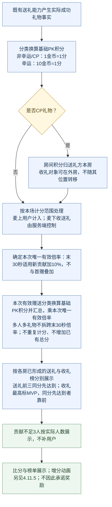

#### 4.10.6 状态与异常

- 一边分数显示延迟时，动画不能代替比分事实；重连读取当前场次，不把补到的表现再次计分。

- 音频、聊天或动画异常不直接等同房间退出、PK终止或消费失败；整场异常去向见3.2。

### 4.11 进行中：单方加分

#### 4.11.1 页面定位与前置条件

本页是进行中页面的单方增分表现，不是独立的手动加分页。仅一方分数增加时，由增分方攻击未增分方，并配合音效；不能按哪方总分更高判断攻击方向。

#### 4.11.2 页面展示与字段


| 内容 | 来源 | 展示或联动 |
|---|---|---|
| 双方积分与比分条 | 本场双方累计PK积分 | 增分结果更新到对应房间；非幸运/CP按1金币=1PK积分、幸运按10金币=1PK积分，CP归送礼方本房，完整口径见3.3 |
| 当前剩余时间 | 本场比赛进度 | 动画播放期间继续展示，不因攻击重新开始计时 |
| 攻击方形象 | 本次唯一增分房间 | 增分方攻击另一方；领先方未增分时也可成为被攻击方 |
| 被攻击方形象 | 本次未增分房间 | 仅为对抗表现，不扣减该房已有积分 |
| 攻击音效 | 单方增分对战素材 | 与单方攻击配合播放；不等同对方房间语音 |
| 主播本场收礼分数 | 对应成员本场有效收礼贡献 | 与对应房间比分保持同一计分来源，不以攻击次数累计 |
| 支持者前三与收礼MVP | 各房本场送礼及收礼排名 | 按当前有效贡献刷新；与4.10共用动态展示；不能将赛中榜直接当A赛终获奖名单 |

双方资料、麦位、公屏、背景及对方音频沿用4.10；不因为进入单方加分状态新增操作按钮。

- 确认仅一方积分增加后，展示该方攻击另一方的动画及音效。

- 双方分数无变化，或2秒内双方都增加分数时，按4.10展示双方互搏。

- 两方总分相等但只有一方本次增分，仍按增分方向表现；两方总分不等但2秒内均增分，仍可进入互搏。

- 进入末30秒后仍按实际增分方向表现；加成改变本笔积分，不产生另一笔“攻击积分”。

- 计分结束后改用结果阶段表现；进行中单方攻击不能提前表示胜方，结算胜负及连胜见3.4。

#### 4.11.3 用户交互

本状态无独立主动操作，动画随有效增分自动展示；送礼、公屏、对方音频及送礼横幅、幸运中奖动画开关沿用4.10.3。

- 单方攻击配合音效播放；本模块不新增音效设置页或静音按钮。

#### 4.11.4 服务端核心逻辑

**表现判定：**仅一方增分时由增分方攻击；无增分或2秒内双方均增分时互搏。此处只判断表现，不用两房总分高低决定攻击方向，不默认每笔礼物延迟2秒。

- 2秒窗口只用于判定对抗表现，不是增加礼物有效期、延长比赛或更改礼物成功时间。

- 同一笔送礼拆成多条消息、动画重播或重复收到提示，不代表再次消费或再次加分。

- 计分基于有效礼物贡献，动画和音效均不是成功扣费凭证；普通送礼是否成功沿既有消费规则判断。

- 攻击命中不扣对手积分，不转移对方贡献，也不使本方额外取得礼物资产或收入。

- 麦上用户必计入、麦下收送礼服务端控制、成员变化不追溯增减积分，按3.3与4.10执行。

- 选择多人送多个礼物按单次赠送，不按内部各份跨末30秒拆倍率；礼物分类分别换算基础积分。动画不作为全部成功的依据。

- 房主、管理员对对方房间声音的总控，以及观众个人静音，不与攻击音效混为一项设置。

- 送礼横幅、幸运中奖动画开关的已定对象不自动扩大到攻击动画、计分更新或攻击音效。

#### 4.11.5 业务流程

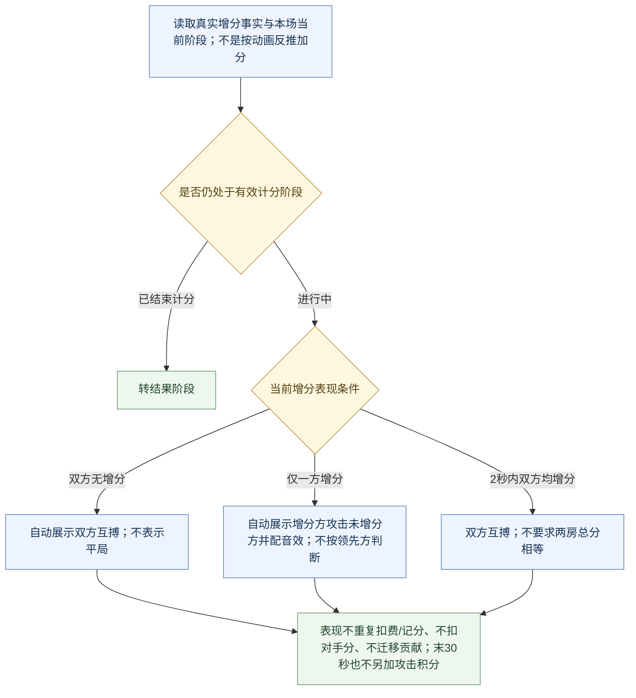

#### 4.11.6 状态与异常

| 场景 | 处理边界 |
|---|---|
| 连续多笔单方增分 | 分数按真实贡献累计 |
| 双方增分通知晚到或乱序 | 不用消息抵达顺序改写贡献 |
| 动画卡顿、素材缺失或音效播放失败 | 不重扣礼物、不补造积分 |
| 重连、切回前台、中途入房 | 读取当前比分与阶段，不把历史攻击当作新送礼 |
| 比赛截单时仍有动画 | 以3.2、3.3的计分边界为准 |
| 音效与语音、公屏或礼物效果同时出现 | 不改变房间声音总控权限 |

宝箱先达、A达标及获奖均依据有效PK积分和对应榜单时点核对，不以攻击次数或动画先后判定；见4.13～4.15。

### 4.12 结束前30秒

#### 4.12.1 页面定位与前置条件

本场PK进入结束前30秒时，显示额外增益10%PK分数提示。仍处于比赛进行中，不切入结果页、不恢复普通房间布局。

本场时长取本局已确定的设置时长；随机异时长经接受取较长时长的场次，也以该本场时长判断末段，不用某一房长期设置单独计时。

#### 4.12.2 页面展示与字段


| 内容 | 来源 | 展示要求 |
|---|---|---|
| 剩余时间 | 本场比赛进度 | 展示当前剩余时间；末段与双方普通倒计时使用同一场次进度 |
| 末段加分提示 | 结束前30秒规则 | 提示额外增益10%PK分数 |
| 双方积分与比分条 | 双方本场累计有效PK积分 | 已有分数持续展示，仅符合末段条件的新贡献使用加成 |
| 双方麦位及个人收礼分数 | 当前麦位成员和各自本场贡献 | 沿用进行中布局与贡献来源，不因末段重新排列或清零 |
| 支持榜前三与收礼MVP | 本场各房当前贡献排名 | 继续显示并按有效贡献更新，不代表已锁定A赛终获奖人或已发放物料 |
| 对战形象 | 当前分数变化情况 | 沿用双方互搏或单方攻击，不因进入末段一律改为某方胜利 |

A达标和C先达抢箱沿4.13～4.15；末30秒礼物的有效PK积分仍参与达标/先达判断。

#### 4.12.3 用户交互

本状态自动展示，无独立主动操作；送礼等沿用既有房间入口，公屏、音频及动画开关沿用4.10.3。

- 对方音频总控、观众个人静音、公屏折叠展开及仅PK可用的动画开关，沿用4.10，不因末段新增权限。

#### 4.12.4 服务端核心逻辑

- 末30秒礼物PK分数额外增加10%；先按礼物类型换算基础PK积分：非幸运/CP为1金币=1PK积分，幸运为10金币=1PK积分，再对适用的新贡献加成。CP积分仍归送礼方本房，计分总规则统一见3.3。

- 仅对适用末段的新有效礼物贡献加成，不将进入末段前累计总分整体增加10%。

- 本局零分时显示的首赠提示及首赠权益不得与末段10%叠加；进入末段不能叠成20%，也不能连续两次乘加成。

- 加成是PK分数变化，不增加礼物资产数量，不据此改变扣费、主播收入或其他既有收益口径。

- 麦上用户必计入；麦下收送礼仍由服务端控制。末段不自动改变收礼对象范围，也不追溯给已下麦成员补分或减分。

- 选择多人送多个礼物按单次赠送，不按批次内各份跨末30秒拆成不同倍率；非幸运、幸运及CP仍按各自分类换算基础积分。

#### 4.12.5 业务流程

末段计分与榜单更新引用4.10.4计分规则及4.10.5计分主图，不重复建立算法。

进入末段 → 自动展示末段提示，继续使用本场剩余时间与当前比分 → 按4.10.4对新有效礼物贡献使用唯一倍率 → 更新对应房间及送/收礼贡献 → 按4.11.5展示增分表现 → 有效计分结束后核对结果。

倒计时结束或有效提前结束后停止收分，分数结算完成后播放庆祝动画、结果弹窗并进入60秒结算，见4.18；恢复布局见4.19，15秒庆祝与60秒结算均不延长有效计分。

#### 4.12.6 状态与异常

- 倒计时结束或有效提前结束后停止收分；分数结算完成后播放庆祝动画、结果弹窗并进入60秒结算，不因最后一条动画未播完继续累计旧局积分。

- 15秒庆祝与60秒结算分别处理，均不延长本场有效计分；恢复布局按4.19，不由本页倒计时直接恢复。

| 场景 | 处理边界 |
|---|---|
| 网络延迟导致晚看到末段提示 | 提示晚到不改变本场时长与实际贡献 |
| 中途入房、重连或前后台切换 | 读取当前剩余时间与分数，不重新开始30秒、不重复给已有分数加成 |
| 提前截单或异常中止 | 异常去向见3.2 |
| 零分房间在末段首次送礼 | 不叠首赠与末段 |
| 末段退款或撤销 | 本期不考虑历史退款，不补追溯改判 |

### 4.13 MVP贡献奖励

#### 4.13.1 页面定位与前置条件

本节承接各房独立达标奖励A的**送礼贡献第1～3名**。本场每房最终有效PK积分达到本场达标目标，该房才具备A资格；不要求先达或最终获胜。败房达标照发，未达标房即便获胜也不取得A。达标时的实时榜仅作提示，**赛终可靠截单后定获奖人**。

#### 4.13.2 页面展示与字段

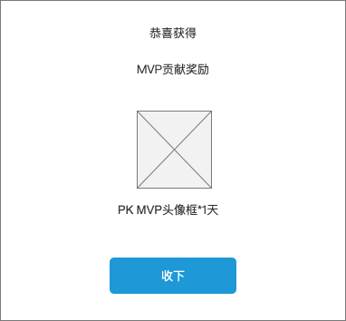

| 区域 | 展示规则 |
|---|---|
| 达标提示 | 本房达到目标时提示已达标，不等于当前前三立即到账 |
| 送礼前三 | 本房赛终有效送礼PK积分第1/2/3名，分房取榜；同分先达到靠前 |
| 奖励 | 第1/2/3名分别为三种**不同样式**头饰框，各1天 |

赛中支持者前三、赛终贡献前三与C抢箱期间前三不是同一份名单；C名单见4.15。本节不增设奖励详情页或兑换操作。

#### 4.13.3 用户交互

达标提示只标本房资格；比赛继续，用户可继续送礼，最终名次可能变动。结束时若本房未最终达标或数据未核对，不按暂居前三承诺到账。

#### 4.13.4 服务端核心逻辑

- 房间达标与胜负分离：按同一场最终可靠积分分别判断两房A资格；每达标房按本房最终送礼贡献分数取实际有贡献的前三名，人数不足只产生实际名次，不递补虚拟用户。礼物类型换算、倍率和房间归属沿3.3。
- 名次对应不同样式1天头饰框；同一用户若又是4.14的收礼榜首，保留两种不同角色位资格，不将其合并成一款或让下一名替代。
- 每场、每房、每名次、每位获奖用户的资格与发奖结果分别留痕；同一资格重复核对/重试不重复到账。
- 达标事实和最终名次核对不同步时，不按动态榜提前发奖；可靠A不被C核对异常拖住，A自身不可核验时只保留待核对资格，不用临时分数发放。
- 历史退款不在本期追溯改判范围。

#### 4.13.5 业务流程

本房有效PK积分达到目标 → 展示A达标提示、继续比赛 → 实际截单并核对本房最终积分和送礼贡献榜 → 最终达标则取本房前三实际名次并分别关联三款1天头饰框 → 核对每项到账状态；结果不可靠则保持该来源待核对，不误发。另一房独立走同一流程，不受本房胜负或C抢箱归属影响。

#### 4.13.6 状态与异常

| 场景 | 边界 |
|---|---|
| 败方达标、胜方未达标 | 败方按A得奖，胜方无A；胜负与连胜照常判断 |
| 赛中前三被反超、成员离房或下麦 | 赛终有效榜定名，已发生有效贡献不因离房迁移；不按首次达标时的暂居名次发奖 |
| 同人同时获贡献位与Host位 | 对应不同款各保留一项资格；送礼榜不向下一名递补 |
| 重复通知、某一项到账失败 | 不重复产生已成功的权益；失败项核对原资产后再恢复 |

### 4.14 MVP魅力奖励

#### 4.14.1 页面定位与前置条件

本节承接A的**本房收礼榜首MVP Host**角色位。同4.13，各房最终达标才有资格，败方达标仍保留；MVP Host是本场收礼贡献最高的可收礼成员，不固定为房主，也不与送礼前三榜合并。

#### 4.14.2 页面展示与字段


| 区域 | 展示规则 |
|---|---|
| 收礼MVP | 本房赛终有效收礼积分最高者；同分先达到靠前；赛中标识是实时展示，不代表提前锁定获奖人 |
| Host奖励 | 与4.13前三不同的第4种样式头饰框，1天 |

#### 4.14.3 用户交互

比赛期间按有效收礼榜动态显示MVP标识；真正获奖人以比赛截单后的可靠最终榜为准。

#### 4.14.4 服务端核心逻辑

每达标房各取自己的最终收礼榜首并关联第4款1天头饰框。与贡献榜角色位分别留资格、分别核对实际到账；同账号双角色不能相互抵销。不能为了凑满四名将Host固定指定房主或把房外收礼者直接纳入本房。

#### 4.14.5 业务流程

本房达标提示 → 比赛继续且收礼榜可能变化 → 截单核对本房最终有效积分及收礼榜首 → 形成Host角色资格与第4款物料 → 分项核对到账；信息不可靠只核对本项，不凭临时MVP标识发奖。

#### 4.14.6 状态与异常

同人兼送礼名次与Host各获对应不同样式；未达标、无可靠收礼榜或数据故障不能虚构Host。收礼人赛中离房/下麦不抹除已有效贡献。Host奖项失败不回滚已成功的本房其他A或C奖项。

### 4.15 率先完成目标奖励

#### 4.15.1 页面定位与前置条件

C为**唯一先达到PK积分目标的房间额外获得抢宝箱资格**，与两房独立达标A并存。抢箱期间该房送礼积分TOP1/2/3各得1天道具；该房抢箱期间送礼PK积分≥10000的用户各得1天参与道具。10000是**PK积分**，不是金币金额，参与奖人数不限定三人。不采用低/中/高三档、金币门槛和全员奖励。

#### 4.15.2 页面展示与字段

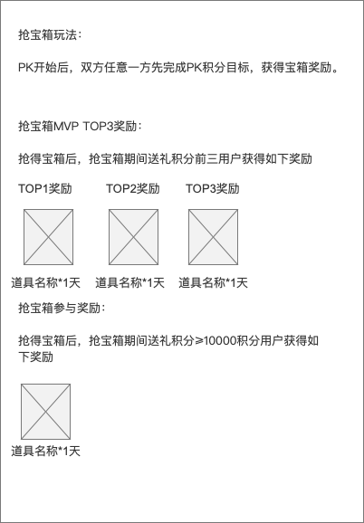

| 区域/规则 | 展示规则 |
|---|---|
| 双房抢箱进度 | 按本场PK积分目标显示；唯一先达后双方宝箱进度冻结，比赛积分和另一房A继续 |
| 先达提示 | 本场唯一可靠先达房获得C资格；先达不等于本场获胜 |
| TOP1/2/3 | 仅先达房从开赛至先达时刻的送礼PK积分第1/2/3名，各1天道具 |
| 参与奖 | 同一先达房在上述期间送礼PK积分≥10000的每位用户，各1天道具；不是房内所有人或收礼MVP |

#### 4.15.3 用户交互

对战中可看到双方抢箱进度；先达后冻结两侧宝箱进度，但比分及另一房独立达标仍继续。若期间榜或唯一先达尚未核清，只能显示核对状态，不能把暂列前三或临时“先达”提示解释为到账。无额外新领奖页。

#### 4.15.4 服务端核心逻辑

- A与C各自截单：A两房分别按赛终积分及赛终送/收礼榜；C仅唯一先达房，保留先达事实及从开赛到先达时刻的本房送礼PK积分榜。不能用赛终TOP3回填C，也不能用C的先达名次提前发A。
- C-TOP3按期间榜取实际第1/2/3名；C-参与奖遍历先达房期间送礼积分≥10000的实际用户，不与前三互斥，也不设人数上限。一个账号可同时获得C两类资格及A相应资格，不以去重吞掉资格。
- 仅有一个宝箱；两房同刻无法可靠判定先后时C保持核对中，不向两房双发。
- 每场、先达房、用户、C奖励类别及TOP名次分别记录资格与到账事实；重试不得重复发已成功项，某类C失败不回滚可靠A。最终胜负只影响结果和房间连胜，不恢复胜方个人奖。

#### 4.15.5 业务流程

开赛后两房累计有效PK积分与抢箱进度 → 唯一房先达目标，记录先达房和时刻、冻结双方宝箱进度 → 截取先达房期间送礼榜及每位送礼者期间PK积分 → 核对TOP3与≥10000两类资格 → 按各自1天物料分别履约；比赛继续至实际截单，另一房也可达标并获A，最终胜负另判。无人先达则无C；先达数据不可靠只使C核对中，不吞掉可核对的A。

#### 4.15.6 状态与异常

| 场景 | 处理边界 |
|---|---|
| 先达房最终被反超或败房最终达标 | C不按最终胜负转移；A按两房各自赛终达标判断 |
| 同人同时在C TOP3且期间积分过万 | 两项C资格均留存 |
| C榜第一赛终跌出前三 | 仍按抢箱期间榜判断C；A只看赛终榜 |
| 无人先达或同刻难判 | 无人先达则无C；先后不可靠则仅C待核对，不双发 |

### 4.16 胜利结算

#### 4.16.1 页面定位与前置条件


正常结束并可靠确认本房获胜后，展示本房胜利结果弹层；对方对应失败结果，不得双方同时显示胜利。失败结果见4.23；4.22提前结束发起方按失败结果衔接，不按比分再判为胜或平。

#### 4.16.2 页面展示与字段

本页凡展示双方房间ID，均按3.1：房主有靓号优先显示房主靓号ID，无靓号沿用原房间ID。

| 区域 / 字段 | 内容与来源 | 展示约束 |
|---|---|---|
| VICTORY | 本场可靠结果中的本房胜利状态 | 败方DEFEAT结果见4.23 |
| Top 3 supporters on my Side | 本场本房送礼贡献PK积分前三 | 分房取榜，不取双方合并榜，不按收礼MVP选人 |
| 前三头像、昵称 | 本房本场结束贡献榜中的用户资料 | 头像可点个人资料；昵称超长跑马 |
| PK Score | 本房本场最终总PK积分 | 不作榜单中某一个人的分数 |
| 再次发起 | 结算期再邀操作 | 与结算期再邀衔接见4.18，不能点击后直接开局 |
| 保存图片 | 本场结果 | 导出本地结果图 |
| × | 弹层关闭入口 | 仅关闭弹层，不等于退出结算阶段 |

#### 4.16.3 用户交互

| 操作 | 可见反馈 / 去向 |
|---|---|
| 点击前三用户头像 | 打开对应用户个人资料，不跳对方房间观战。 |
| 点击“再次发起” | 按4.18发起向原对手的新邀请；等待本次响应，不直接开局。 |
| 点击“保存图片” | 将本场结果保存为本地图片；不打开系统分享面板，不扩社交发布或分享奖励。 |
| 点击× | 仅关闭本人结果弹层；不恢复双方布局、不撤回新邀请、不改变旧结果或连胜。关闭后不可重看；仍在阶段时保留原剩余时间和邀请状态。 |

#### 4.16.4 服务端核心逻辑

**结果核定**

- 胜负判定读取3.4的本场可靠结果；计分及截单范围沿用3.3，不按当前背景比分、百分比或打斗动画重新判定。

**贡献前三与分房归属**

- 前三按本场最终有效送礼贡献取人，同分先达到者靠前；贡献人数不足3人按实际人数展示，不补用户。

- 支持者是送礼用户；MVP是本房收礼积分最高成员，不能把房主或收礼MVP固定填进支持前三。

**结算再邀衔接**

- “再次发起”只向原对手创建新邀请，仍须对方本次有效接受；不能复用旧局接受状态。

- 结算期再邀按钮仅结算期间当前有PK权限者可见；操作须满足3.1原发起者限制，完整核对、占用、接受及转场规则见4.18。

- **收到重复结果：** 仍展示同一场结果，不重复改变连胜；具体更新口径引用3.4

- **本场支持者已离房或下麦：** 已发生的有效贡献不因此迁移或删去。

- **双方结果对照：** 同一场双方最终积分及结果必须成对；弹层不添加双分数布局。

正常到时后按双方可靠最终积分比较：高分方胜，另一方负，相同则平（含双0）。提前结束按4.22保留发起方默认失败，不进入高分胜或同分平分支。数据缺失不当作0；无明确胜负的异常中止不套用正常胜负。双方结果对照不新增双比分布局。

#### 4.16.5 业务流程

**结果核对与分房展示**

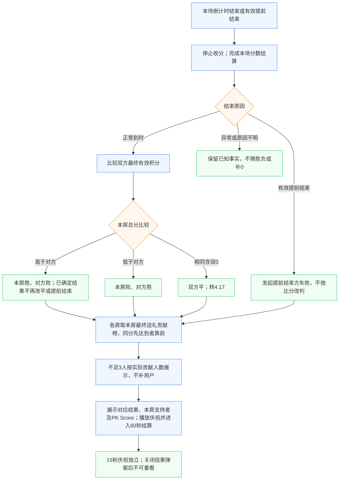

倒计时结束或有效提前结束停止收分，分数结算完成后播放庆祝动画、结果弹窗并进入60秒结算；15秒庆祝独立，不等其播完才启动60秒。

#### 4.16.6 状态与异常

- 分数结算完成后播放庆祝动画、结果弹窗并进入60秒结算；15秒庆祝独立，结束不退出60秒阶段。旧庆祝未播完时，他人不能向该房发起PK；不据此扩大为本方永久禁发。

- 本房最终达标时，A按本房赛终送礼前三及MVP Host定人；唯一先达房的C按期间榜判断，见4.13～4.15。胜利本身不产生个人奖励。

- 正常结束按结算完成的积分判断胜负，提前结束保留已生效判负；不将长期核对作为正常流程，也不将缺失数据填0。已确定胜利不能再改为平局或提前结束；本期不考虑历史退款，不补追溯改判。

| 状态 / 场景 | 产品表现与约束 |
|---|---|
| 正常胜负已确认 | 胜方攻击败方；胜方麦上用户庆祝，层级在表情之上，败方麦上用户投降 |
| 庆祝播放 | 庆祝动画15秒，与60秒阶段独立；15秒结束不自动退出整个结算阶段 |
| 败方查看 | 显示与胜方相反的结果，贡献前三与PK Score仍取败方自己的本房数据 |
| 数据异常 | 不猜胜负、不补0；保留已生效结果，不设正常流程长期核对分支 |
| 关闭后仍处于结算阶段 | 关闭后不可重看；保留阶段当前剩余时间与当前邀请状态，不重置60秒 |

### 4.17 平局结算

#### 4.17.1 页面定位与前置条件


正常结束后，双方最终有效PK积分可靠确认相同，展示平局结果。两房结果均为平局，不从某个头像、进度百分比或动画表现中选出胜方。

#### 4.17.2 页面展示与字段

本页凡展示双方房间ID，均按3.1：房主有靓号优先显示房主靓号ID，无靓号沿用原房间ID。

| 区域 / 字段 | 数据来源与含义 | 显示要求 |
|---|---|---|
| DRAW | 本场可靠平局结果 | 双方同步为平局，无胜方/败方 |
| Top 3 supporters on my side | 本房本场最终送礼贡献前三 | 不将双方支持者合并，不取收礼MVP替代 |
| 三个头像与昵称 | 对应前三用户资料 | 头像点击个人资料，昵称超长跑马 |
| PK Score | 本房本场最终总PK分数 | 展示本房真实总分 |
| 再次发起 | 结算期再邀操作 | 是发起新邀请，不是自动接受或直接计分 |
| 保存图片 | 本场平局结果 | 保存本场结果图到本地，不扩社交分享 |
| × | 弹层底部关闭入口 | 仅关闭弹层，不使双方退出阶段 |

#### 4.17.3 用户交互

| 操作 | 可见反馈 / 去向 |
|---|---|
| 点击前三头像 | 打开对应个人资料，不触发跳房、送礼或PK邀请。 |
| 点击“再次发起” | 向原对手发新邀请，等待响应；完整业务规则见4.18。 |
| 点击“保存图片” | 将本场平局结果保存到本地。 |
| 点击× | 只关闭本人弹层，关闭后不可重看；仍在结算阶段时沿用原倒计时，已发邀请继续有效。 |

#### 4.17.4 服务端核心逻辑

**可靠平局判定**

- 双方均0分与双方非0同分均按可靠最终积分判断，不限定只支持零分平局。

- 平局结果读取3.4，积分范围读取3.3；数据缺失与真正0分必须分开。

- 异常中止不因中止时比分相同而直接当作平局；结束原因未明确时保留核对。

**本房贡献榜**

- 两房各展示自己的本房贡献前三；同一用户分别支持两房时，贡献各归各房，不做全场合榜。

- 同分先达到者靠前；贡献人数不足3人按实际贡献人数展示，不补房主、收礼成员或随机用户。

- MVP属于收礼榜第一名，收礼最高同分先达到者靠前，与本页送礼前三是不同口径；平局不取消两类数据的区分。

**再邀与阶段衔接**

- 点击图中“再次发起”向原对手发新邀请，完整规则见4.18；旧结果核对完成才可发起、才可接受。

- 结算期再邀按钮仅当前结算期间有PK权限者可见；操作还须满足3.1等待原发起者限制，管理员身份本身不提供授权。

- 结算期再邀不要求先关闭平局弹层或等60秒结束，不额外规定同对手必须再等30秒。

- **平局重复通知：** 同一场只读取同一份结果，不因重复显示重复处理连胜

#### 4.17.5 业务流程

平局分支引用4.16.5“结果核对与分房展示”：可靠结果同分（含双0及非0同分）→双方DRAW→各取本房贡献前三与单个本房PK Score。后续再邀、接受、阶段退出与旧事件隔离引用4.18.5；不另算胜负或重开60秒。

#### 4.17.6 状态与异常

| 状态 / 场景 | 页面或业务处理 |
|---|---|
| 可靠平局 | 双方互搏，不播放单方胜利攻击或败方投降 |
| 麦上结算效果 | 双方麦上用户显示庆祝动画；庆祝层级在表情之上 |
| 奖励资格 | 平局不产生胜方个人奖；两房分别最终达标时各自判A；唯一可靠先达房单独判C，同刻无法判先后不双发 |
| 庆祝15秒结束 | 只结束庆祝播放，不据此恢复房间布局或重置结算阶段 |
| 数据异常 | 不把暂时相同或缺失的比分确定为平局，不设正常流程长期核对分支 |
| 阶段退出 | 按4.18退出旧局展示；不能把退出当作平局核对成功 |
| 已进入新局3秒准备 | 旧弹层操作与旧局到时不得取消新场，读取新场当前状态 |

### 4.18 60秒结算阶段与下一局

#### 4.18.1 页面定位与前置条件


- 比赛倒计时结束或有效提前结束时停止收分，分数结算完成后播放庆祝动画、结果弹窗并进入60秒结算。15秒庆祝独立，不等动画播完才开始60秒。

- 本模块使用3.1权限、3.2状态时间占用、3.3计分和3.4结果连胜规则，不改变旧局结果。

#### 4.18.2 页面展示与字段

本页凡展示双方房间ID，均按3.1：房主有靓号优先显示房主靓号ID，无靓号沿用原房间ID。

| 内容 | 来源 | 展示 / 操作要求 |
|---|---|---|
| 结算剩余时间 | 旧局当前结算阶段剩余时间 | 阶段时长60秒；不当作新一局比赛时长 |
| 双方房间及比分 | 旧局双方身份、已可靠确认的旧局结果 | 仍属旧场展示，不把新普通礼物累计到旧分数 |
| 原麦位与成员 | 当前结算房间布局 | 保留现有展示，退出后的恢复由4.19承接 |
| 立即结束 | 旧局阶段仍有效且当前有PK权限 | 双方当前有PK权限者可见；退出阶段后不显示旧按钮 |
| 再来一局 | 同上，且发起时核对完成、原对手可邀 | 只向原对手发邀请，尚未接受不等于开局 |

#### 4.18.3 用户交互

| 操作 | 可见反馈 / 去向 |
|---|---|
| 有当前PK权限者点击“立即结束” | 满足当前链路操作人限制后，双方退出旧局结算展示并恢复布局，无需对方同意，容量足够时麦上成员无需下麦，容量不足仅按4.19的PK麦序倒序下麦够缺口。 |
| 有当前PK权限者点击“再来一局” | 对原对手发新邀请；有效发出后等待本次响应，不直接开局。 |
| 对方有效接受再邀 | 立即转入新局3秒准备；准备不可主动取消。 |
| 对方拒绝再邀 | 不进入新局；旧阶段若仍在，继续原剩余时间。 |
| 关闭本人结果弹层 | 只收起本人弹层，关闭后不可重看；阶段与邀请状态不因关闭改变。 |

#### 4.18.4 服务端核心逻辑

结算阶段保留双方PK展示，并提供“立即结束”“再来一局”。阶段60秒与庆祝15秒独立，旧局截单后不再累计本阶段新发生的礼物积分。

- **核对完成状态：** 旧局当前结果核对情况；发起与接受两个时点均校验，不能以展示退出替代

- **再邀状态与有效期：** 新邀请当前有效状态及原有效期限；与旧阶段独立；发起后总时长30秒，30秒内未被接受则废弃；不因旧展示退出重新计时

- **当前占用与资格：** 两房当前有效邀请/准备/比赛、授权与房间资格；不凭恢复普通布局解除有效占用

**权限与退出旧展示**

- 仅结算期间双方当前有PK权限的用户可见两按钮；操作时还须复核当前链路限制。无邀请/匹配等待链路时沿现有阶段权限；已有再邀待响应时，本房仅原发起者可继续操作，其他成员提示“有其他成员正在进行PK操作，无法继续操作PK。”，不能用“立即结束”绕过限制。系统60秒到时不属于成员操作，仍按原阶段规则处理。

- 原发起者撤权后不得继续操作，等待中不由其他成员代操作。成局后权限身份变化不影响房间继续比赛；房主不可变更。

- 任意一方有权限且满足当前操作人限制的用户点击“立即结束”，双方立即退出旧局结算展示并恢复房间布局，无需另一方同意，容量足够时麦上成员无需下麦，容量不足仅按4.19的PK麦序倒序下麦够缺口。

- 该动作不是进行中的提前结束，不修改截单时点、胜负或连胜，也不使尚未完成的核对自动完成。

- 60秒到时同样退出双方旧展示并恢复布局；15秒庆祝结束不触发此动作。

- 已发再邀尚未响应时，立即结束或60秒到时只影响旧展示；原邀请按原有效期继续等待并保留邀请占用。

- 不提供邀请撤回，不允许借恢复布局匹配第三房、重复邀请或绕过旧局核对限制。

- 无待响应邀请也不能忽略旧局未完成核对；普通房间恢复与恢复新PK资格分别判断。

**发起时复核与邀请创建**

- 点击“再来一局”时，重新检查操作者当前PK权限、旧结果已核对完成、原对手身份、双方资格与有效占用。黑名单、模式和邀请设置按原规则复核。

- 旧结果未核对完成，不发送邀请；旧展示尚未结束不是向原对手再邀的拦截理由，不要求先退出或等满60秒。

- 本次新邀请只发给上一局原对手；第三方邀请、搜索及随机路径不享受旧展示期的该项例外。旧庆祝未播完时，他人不能向该房发起PK；不据此增加动画播完才进60秒或本方永久禁发的规则。

- 发出后等待本次有效响应，不沿用上一局已接受状态，不自动开局；有效期与占用沿邀请模块。

- 服务端移除已选档位时，以新默认档位作为后续发起/匹配PK时长。

**接受时复核与新局准备**

- 接收侧房主及有PK权限的管理员可接受或拒绝，以最先操作者为准；接受时再核对旧结果已核对完成、当前接受操作权限、邀请有效且双方仍可开局，不能只沿用发起时校验。

- 有效接受后立即转入新局不可主动取消的3秒准备，3秒动画播完自动开赛并开始计分，无需双方确认就绪，准备期不计PK积分；不等旧60秒走完。

- 新局有独立积分和贡献，不复用旧接受、旧分数及旧状态。

**拒绝、到期与冷却边界**

- 拒绝或到期不生成新局；旧阶段仍在时继续原剩余时间，不重新启动60秒，也不因拒绝立即结束旧阶段。

- 若邀请在旧展示退出后才被有效接受，仍直接进入新局3秒准备；布局已恢复不使邀请失效。

- 定向邀请被拒绝后允许立即向另一房发起，不增加再来一局必须额外等待30秒的条件。

**并发与跨场隔离**

- **同房多人或双方同时再邀：** 已有本房他人发起的再邀等待时，非发起者操作拦截并提示“有其他成员正在进行PK操作，无法继续操作PK。”。同人重复、尚无链路的同时发起和双房竞争不双开、不自动互相接受，真正同时发生的竞争随机取一方结果统一生效，非同刻保留已先生效结果；有效接受已先生效后，旧按钮不得随机翻案。

- **有效接受先完成：** 立即进入新局准备；迟到的旧“立即结束”或旧到时事件不得结束新准备/进行中

- **旧展示退出先完成：** 只结束旧展示；之后仍可有效接受原邀请，进入新准备

- **接受与拒绝/邀请到期并发：** 沿用邀请模块唯一有效响应，不重复准备、不开第二场

- **点击时撤权或房间资格变化：** 按当前权限和资格拦截，不用旧按钮放行。

- **数据异常：** 不猜胜负、不填0，不将长期核对跨过60秒设为正常分支。

**旧展示退出与有效再邀是两条独立链路。** 退出旧展示不结束已有效再邀，不释放其占用；有效接受优先进入新场后，旧按钮和旧到时只能读取当前状态，不得作用于新场。

#### 4.18.5 业务流程

**旧结算展示退出**

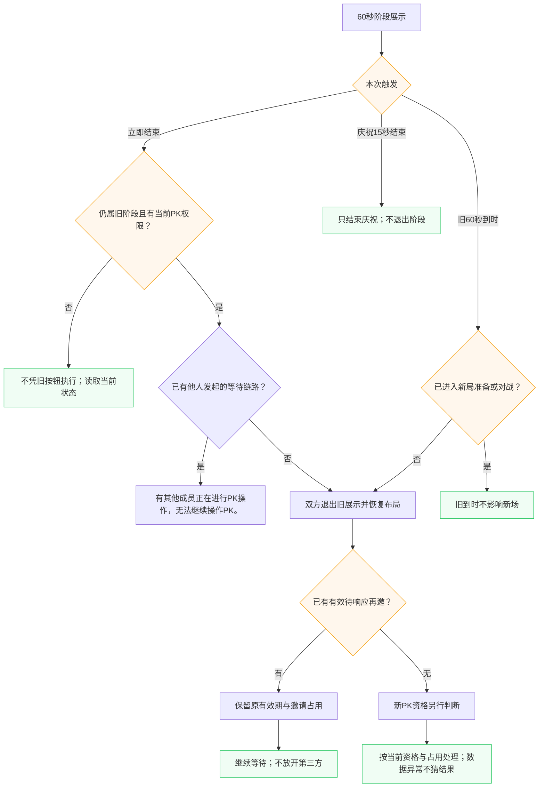

本图从分数结算完成后的60秒阶段展示开始，庆祝动画、结果弹窗与阶段衔接按4.18.1；15秒独立，不延长收分或延后60秒起算。

**原对手再邀与新场隔离**

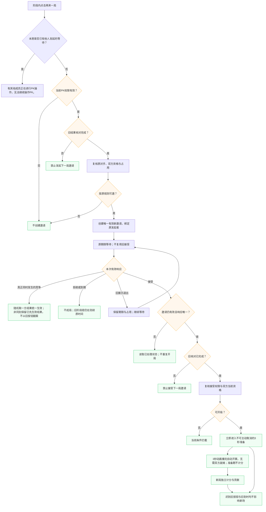

阶段内向原对手再邀无需先退出或等60秒；第三方、搜索、随机路径不享受此例外。重复/双向再邀不自动互相接受；本房非发起者等待中操作使用指定提示，真正同时发生的竞争随机取一方结果统一生效，非同刻保留已先生效结果；旧按钮不翻案。

#### 4.18.6 状态与异常

- 结果弹层可独立关闭，关闭后不可重看；关弹层不退出阶段，不重置阶段倒计时。旧庆祝未播完时，他人不能向该房发起PK；不扩为本方永久禁发，不让旧动画控制已生效新局。

| 场景 | 唯一有效结果与页面反馈边界 |
|---|---|
| 再邀已发又立即结束 | 双方退出旧展示，邀请继续等响应，无撤回入口 |
| 再邀等待跨过旧60秒 | 旧展示结束，邀请不重新计时、不被自动撤销，第三方仍受占用限制 |
| 重连或重进房 | 读取当前旧展示/再邀/新准备状态，不按本地旧倒计时重开阶段 |

### 4.19 恢复房间麦位

#### 4.19.1 页面定位与前置条件

旧局60秒结算阶段到时，或任意一方当前有PK权限且满足3.1等待操作人限制的用户点击“立即结束”后，双方退出旧局结算展示并恢复普通房间布局；容量足够时在麦成员无需下麦，仅容量不足按本节规则下麦够缺口。操作与可见结果见4.19.3。

- 60秒结算与15秒庆祝分开处理；庆祝15秒结束不能单独触发恢复房间布局。

- “立即结束”属于结算阶段操作，不是进行中提前结束PK；可见与操作权限见3.1及4.18。

- 对原对手的新邀请有效接受后，进入新局3秒准备；此时不得再执行旧场恢复覆盖新场。

- 其他异常按3.2对应阶段处理，不将本模块扩大为所有断线均自动退出。

#### 4.19.2 页面展示与字段


| 内容 | 来源 | 恢复要求 |
|---|---|---|
| 普通房间麦位布局 | 当前房型与房间有效麦位状态 | 从旧PK对战布局回到普通布局 |
| 麦上成员 | 恢复时仍在本房有效在麦的成员 | 按PK麦序升序入座普通房前12麦；容量不足仅按PK麦序倒序下麦够缺口，不全员下麦再上麦 |
| 头像、昵称与发言状态 | 当前成员资料及房间状态 | 按房间现状展示，不能把PK前已离房用户恢复为在麦 |
| 房间信息及底部操作区 | 当前普通房间页面 | 恢复既有房间使用，不增加专门的恢复确认或重新入座按钮 |
| 公屏区域 | 普通房间聊天状态 | 恢复普通房间承载 |

本页不继续展示旧局实时计分；历史结果、积分及连胜按3.3、3.4保留，不因布局切换清除。

#### 4.19.3 用户交互

| 用户动作 | 可见结果 |
|---|---|
| 任意一方当前有PK权限的用户，在结算阶段点击“立即结束” | 满足3.1操作人限制后双方退出旧局结算展示、恢复各自普通房间布局；非发起者不得操作已有等待链路。容量足够时麦上用户无需下麦，容量不足仅按PK麦序倒序下麦够缺口；新局已准备/进行中时旧按钮不得影响新局 |

60秒到时为自动转场，不是点击操作；15秒庆祝结束不能单独触发恢复。恢复后沿用普通房间既有操作，无恢复确认、重新入座按钮或恢复设置页。

#### 4.19.4 业务处理规则

- 恢复是布局转场，不是强制全员下麦；不能为了重建座次让全部用户重新排麦。

- 每房PK容量12麦。恢复时取上一局PK前12个麦位中仍在本房有效在麦的用户，按PK麦序升序放入普通房前12个麦位；普通房容量不足时，从PK麦序倒序下麦够容量缺口。该下麦仅适用于明确容量缺口，不用于一般原位冲突、锁麦或全员重排；不让两人占同一位置。

- 已离房、已主动下麦的成员不能按PK前名单自动拉回；其已产生的本场积分与贡献仍保留原归属。

- 布局恢复不自动授予发言或管理权限。

- 恢复普通布局不代表旧结果已核对完成；未核对完成仍不能发起或接受下一局邀请。

- 已发原对手再邀尚未响应时，“立即结束”或60秒到时只结束旧局展示；原邀请继续原有效期并保留占用。

- 因此，已看到普通房间布局也不能绕过邀请占用去匹配第三房；有效拒绝、到期或既有失效路径按3.2处理。

- 原邀请之后被有效接受，进入新局不可主动取消的3秒准备，不沿用旧接受状态或旧局贡献。

- 若新局先进入准备或进行中，旧局恢复动作、旧按钮和旧60秒到时均不得退出新场或重置新麦位布局。

- 布局恢复不重算胜负、不重复更新连胜；历史展示和最终结果关系见3.4。

#### 4.19.5 业务流程

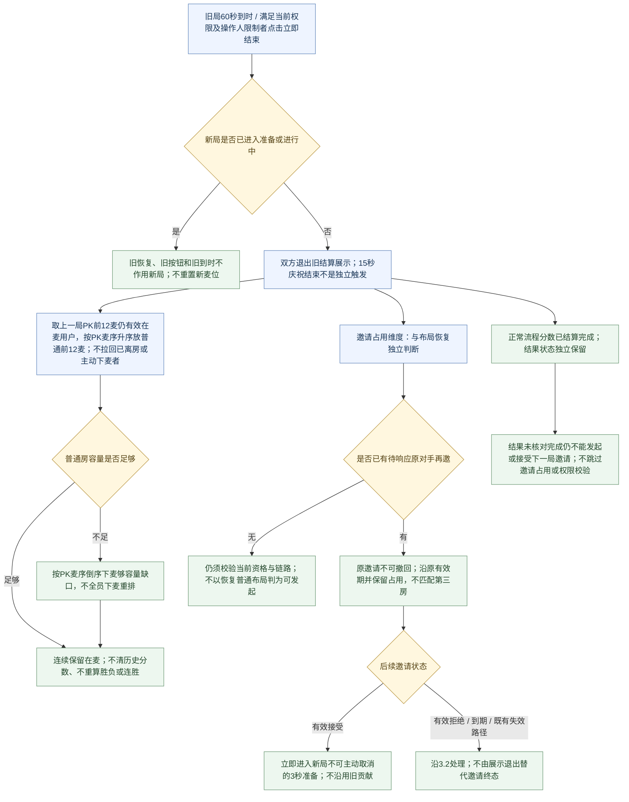

仅明确容量缺口执行PK麦序倒序下麦；不按低贡献或后加入下麦，不执行全员重排下麦。

#### 4.19.6 状态与异常

| 场景 | 处理约束 |
|---|---|
| 恢复时对方声音仍在播放 | 不能把旧对手声音误用于下一局 |
| 重连时旧场已恢复 | 以当前场次与房型展示，不补演旧PK布局后再次强制恢复 |
| 两方先后退出结算展示 | 恢复目标均为各自普通房间；一端晚收到不代表另一端仍可操作旧按钮 |
| 多次收到旧场恢复或到时 | 不重复移动成员，不覆盖已经生效的新场布局 |
| 普通房容量不足 | 按PK麦序倒序下麦够缺口，不扩大下麦范围 |
| 普通布局恢复但数据仍在核对 | 展示退出与占用分开；不把恢复成功当作结果核定成功 |

### 4.20 PK战绩

#### 4.20.1 页面定位与前置条件


从PK对手选择页的战绩入口进入，查看发起/受邀记录及对应结果，并可向记录中的原对手再次发起。页面只定义当前最小列表，不新增排行榜、筛选器或战绩详情页。

- 保留Initiated与Invited me两个页签。

- Initiated表达发起方向，Invited me表达受邀方向；战绩按房间归档，不按操作管理员个人归档。

- 受邀不等于所有参与过；旁观、送礼或上麦不自动产生“Invited me”记录。

#### 4.20.2 页面展示与字段

| 字段 / 控件 | 数据来源 | 产品含义与限制 |
|---|---|---|
| Initiated / Invited me | 记录的发起/受邀关系 | 切换读取对应记录集，不按结果胜负分组 |
| 对手头像、昵称 | 本条记录对应对手资料 | 展示记录对应对手的头像和昵称 |
| ID | 本条记录对应对手房间ID展示 | 房主有靓号优先显示房主靓号ID，否则沿用原房间ID；不因展示靓号改变记录归属，查房同时支持原房间ID |
| 日期与时间 | 本条记录对应时间 | 展示日期及时分秒 |
| VICTORY / DEFEAT / DRAW | 同场可靠最终结果 | 从本列表所属方视角显示胜/负/平，不把受邀统一记成失败 |
| 再次发起 | 本房房主/管理员身份可见的记录操作 | 当前操作还需校验PK授权与房间资格，不因按钮可见默认允许 |
| 已邀请 | 对该对手当前有效邀请状态 | 不是从历史比赛曾接受推导 |
| 左上返回箭头 | 当前页面返回入口 | 离开列表，不撤回邀请、不改变场次结果 |

#### 4.20.3 用户交互

| 操作 | 可见反馈 / 去向 |
|---|---|
| 从PK对手选择页点击战绩入口 | 进入PK战绩列表。 |
| 切换Initiated / Invited me | 显示对应发起/受邀方向记录，不按胜负分组。 |
| 点击“再次发起” | 通过当前资格复核后向该记录对手发新邀请；有效发出显示“已邀请”，不直接开局。 |
| 点击左上返回箭头 | 离开列表，不撤回邀请、不改变场次结果。 |

#### 4.20.4 业务处理规则

**记录归档与结果读取**

- 提前结束已生效时，发起该操作的一方按本场失败结果读取DEFEAT，不因当时比分领先、相同或原发起/受邀方向而改判；与正常结束和异常中止分清结束原因，不据此新增战绩列。

- 切换页签显示本房对应发起/受邀方向记录；管理员代发仍归房间，不归管理员或房主个人。成局后由该房完成本场，管理员权限或身份变化不影响场次与PK流程；后续操作仍复核当前权限。

- 每条胜/负/平读取本场最终结果，与结算页面同源；不按当前房名、实时分数或后续规则重新计算。

- 已发邀请、等待响应和已正式成局是不同状态；不得给未成局邀请补胜/负/平。

- 同一对手可以有不同场次的历史记录。

**发起时复核与邀请创建**

- “再次发起”仅房主和管理员可见；执行时检查当前管理身份与PK授权，管理员身份不等于自动获授权。

- 重新检查本房模式、PK黑名单、对手邀请设置、双方当前占用及旧局结果核对完成情况；不凭历史曾成局而跳过。

- 旧结果未核对完成时不发起，也不允许对方接受下一局；即使列表已显示旧结果或房间已恢复普通布局，仍以当前核对状态为准。

- 校验通过只向该记录的对手发送新的定向邀请，不能直接进入准备或沿用旧局接受。

- 有效邀请已发后显示“已邀请”，防止重复创建；等待按原邀请规则处理，不新增撤回。

**接受时复核与当前邀请状态**

- 接受时再次复核邀请有效、当前权限、旧核对完成与双方资格，再进入不可主动取消的3秒准备；随后才计新局分。

- “已邀请”必须反映当前有效链路，拒绝、到期或已处理后更新相应状态。

- 该入口属于普通战绩再邀，不把它默认当作4.18的结算期展示例外；结算阶段“再来一局”走原对手专用路径。

- 定向邀请被拒绝后允许立即向另一房发起。

**重复操作与撤权**

- **同房多人/多端同时再发起：** 已有他人发起的邀请/匹配等待时，拦截非本人操作并提示“有其他成员正在进行PK操作，无法继续操作PK。”；本人重复不创建新链路；真正同时发生的竞争随机取一方结果统一生效，非同刻保留已先生效结果，已先接受后旧按钮不得随机翻案。

- **操作前被撤销授权：** 限制后续PK权限相关操作，不允许凭旧列表发起；等待中不允许其他成员代操作，不增补接管处置；已成局仍跟随房间完成，不因管理员权限和身份变更中止。

**记录读取与当前资格分开。** 战绩只读取同场可靠结果；再邀按当前条件重新判断。历史记录存在、旧页面按钮可见、旧场曾有效接受，都不代表当前可再次开局。

#### 4.20.5 业务流程

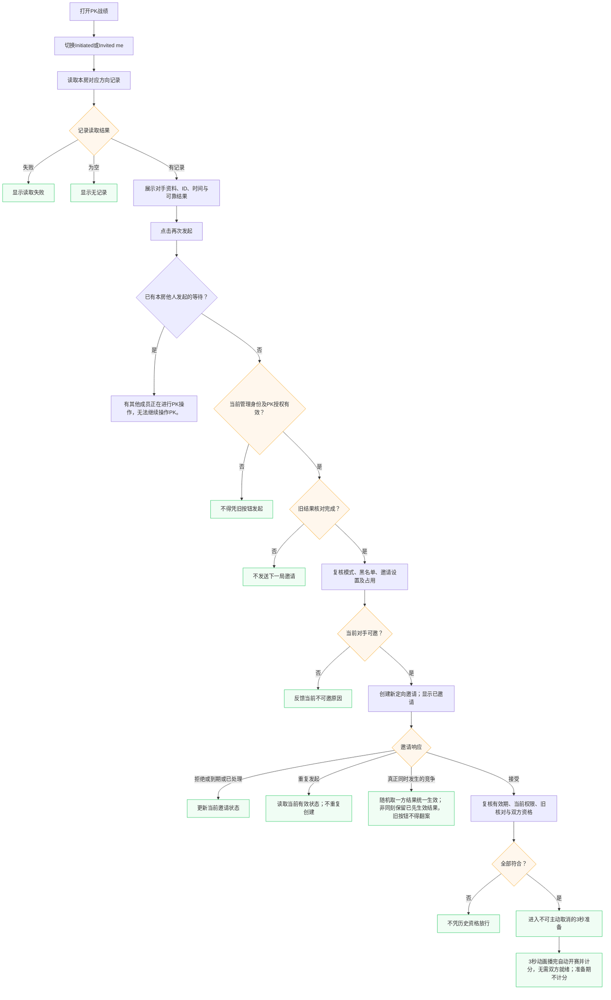

正常到时或有效提前结束后停止收分，分数结算完成后衔接结果与战绩，不将长期核对设为正常分支。实际数据异常不猜胜负或填0，保留已生效结果；已确定胜不能改平或提前结束，本期不考虑历史退款、不补追溯改判。普通战绩再邀不自动获得4.18结算展示期例外；战绩归房间。

#### 4.20.6 状态与异常

| 状态 / 异常 | 处理约束 |
|---|---|
| 记录数据异常 | 不伪造胜/负/平或补0；保留已生效结果，不设置正常流程长期核对分支 |
| 有效邀请仍在等待 | 返回列表或退出旧结算展示不使邀请撤回，保留原有效期及占用 |
| 对手关闭、忙碌或不可邀 | 不创建新邀请，反馈当前不可邀原因 |
| 对手改名、注销或房间私密变化 | 不改变历史结果 |
| 空列表与读取失败 | 分别呈现无记录和加载失败，不用空列表掩盖失败 |

### 4.21 跳转对方房间观战确认

#### 4.21.1 页面定位与前置条件

在PK页面点击对方主播或对方房间信息时，先弹出观战跳房确认，不直接切换房间。点击对象用于识别当前对手房间，不增加新的资料页分流。

#### 4.21.2 页面展示与字段

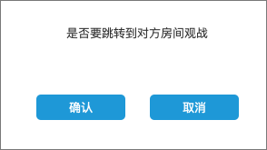

| 内容 | 来源 | 展示与含义 |
|---|---|---|
| 提示文案 | 跳房确认提示 | “是否要跳转到对方房间观战” |
| 确认 | 弹窗左侧按钮 | 同意本次跳转，在具备进入资格时前往当前对手房间 |
| 取消 | 弹窗右侧按钮 | 不执行跳转，保留当前房间 |
| 目标房间 | 本场对手房间关系及本次点击对象 | 作为跳转依据，非新增显示字段；不要求用户重新输入ID |

#### 4.21.3 用户交互

- 用户点击对方主播或对方房间信息，打开本次确认弹窗；点击本身不代表已经离房。

- 点击“取消”关闭本次确认，不跳房，不改变双方比赛进度、已有贡献及房间占用。

- 点击“确认”后按现有房间进入能力前往对手房间观战；确认不是加入对手麦位，也不是新发起或接受一局PK。

- 成功切房后以目标房间当前阶段展示；不能把原房间的旧比分或倒计时当成目标房间的新一局。

- 取消后再次点击对方信息仍走确认流程；不新增“永久允许自动跳房”的偏好。

#### 4.21.4 业务处理规则

同一确认重复点击不得造成反复切房；成功进入才算实际切房，不将点击“确认”等同入房成功。房主/管理员/麦上成员跨房及音频、跨服务兼容场景沿用原能力，本期不新增专项处理。

- 目标必须对应本次确认的对手，不能因后台换局、重连或资料更新而静默跳到无关房间。

- 同一确认的重复点击不得产生反复切房。

- 普通观众的跳房行为与房间本身PK状态分开，不能将个人离房理解为一房退出PK。

- 权限归当前所在房间与当前身份，不因曾在原房间担任管理员就取得目标房间管理或PK操作权限；具体操作权限见3.1。

- 历史贡献按发生时房间分别保留，切到对方房间不迁移、不抵消原贡献，也不把两房支持榜合并。

- 同一用户之后分别支持两房时，新增贡献按3.3的有效送礼归属处理；跳房确认本身不产生积分。

- 点击对方主播不等于新增任意礼物跨房赠送能力；已有CP礼物允许赠送给不在本房间的对象，所赠CP礼物PK积分按3.3归送礼方本房。本弹窗只承接观战跳房，不新增或改造送礼入口。

- 跳房不解除两房PK占用、不取消3秒准备，不构成进行中的提前结束或结算“立即结束”。

#### 4.21.5 业务流程

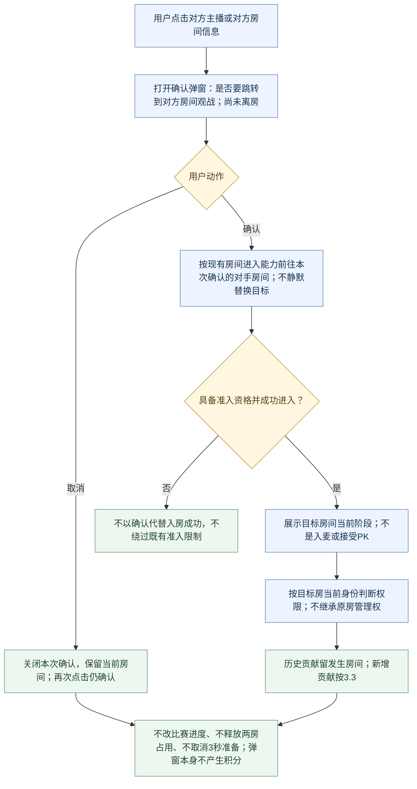

跳房不是新增跨房送礼授权，也不是进行中提前结束或结算“立即结束”；已有CP跨房赠礼仍按3.3计入送礼方本房。

#### 4.21.6 状态与异常

| 场景 | 业务边界 |
|---|---|
| 目标房间私密、禁入或资格受限 | 沿既有房间准入能力；确认不绕过限制 |
| 目标房间已关闭或不可达 | 不以确认成功冒充入房成功 |
| 弹窗期间PK结束 | 结束本身不代表用户同意跳转 |
| 弹窗期间进入新局或对手改变 | 不静默替换目标 |
| 点击取消、关闭弹窗或断网 | 未有效入房不迁移贡献、不释放PK占用；房间连接恢复按现有能力处理 |
| 确认者是房主、管理员或在麦成员 | 本期暂不新增专项处理，沿用原能力；不补自动转让房主、下麦或强制结束PK方案 |

### 4.22 提前结束PK

#### 4.22.1 页面定位与前置条件

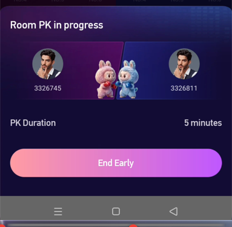

本面板用于本场PK进行中查看对阵信息，并发起提前结束；不是邀请撤回、3秒准备取消，也不是结算阶段的“立即结束”。

发起提前结束PK的一方默认为PK失败方；提前结束生效后立即结束PK并进入结束流程。

#### 4.22.2 页面展示与字段

| 内容 | 字段 / 数据来源 | 展示说明 |
|---|---|---|
| 面板标题 | Room PK in progress | 表明当前为进行中的本场PK |
| 双方头像与标识 | 当前对阵双方房间资料 | 房主有靓号优先显示靓号ID，否则沿用原房间ID |
| 对阵形象 | 本场对阵双方 | 作为本场PK展示，不作为胜负判断依据 |
| 本场时长 | PK Duration | 读取本场已确定时长，不是剩余时间或提前结束的等待门槛 |
| 提前结束按钮 | End Early | 发起提前结束本场PK；生效后发起方默认失败并立即进入结束流程 |

#### 4.22.3 用户交互

| 用户操作 | 页面反馈 / 去向 |
|---|---|
| 打开进行中的PK操作面板 | 展示本场双方资料、时长和End Early |
| 点击End Early，当前操作资格及进行中状态校验通过 | 本场提前结束立即生效，发起提前结束的一方默认失败；进入结束流程，发起方失败结果见4.23 |
| 操作时已经结束或当前不具备操作资格 | 不凭旧面板重新结束或改判 |

不增加二次确认或等待对方同意的操作步骤。

#### 4.22.4 业务处理规则

1. **适用阶段：** 处理本场进行中的提前结束。执行时读取当前场次状态与操作者当前提前结束操作资格；不因已有发起邀请权限默认取得本操作权。
2. **判负对象：** “发起方”指发起本次提前结束操作的一方房间，不是固定指最初发送PK邀请的一方，也不是只将操作者个人记为失败。
3. **确定结果：** 提前结束生效时，发起方默认判为本场失败。即使当前比分领先或相同，也不按比分将该方改判为胜或平。
4. **立即结束：** 生效后立即结束本场PK并进入结束流程，不继续等待原定比赛时长，也不等待对方接受、拒绝或请求超时。本场停止继续收分；成功事实、晚到贡献及边界归属沿3.3。
5. **判负与数据核对分开：** 发起方失败按提前结束原因确定，不依赖双方积分比较。比分、贡献及榜单仍读取本场可靠事实；有效提前结束后停止收分并完成分数结算，不以比分撤销判负。缺失数据不填0，不将长期核对设为正常出口。
6. **结束衔接：** 结果展示、结算阶段、麦位恢复、战绩和再邀沿现有结束链路；有效提前结束时停止收分，分数结算完成后播放庆祝动画、结果弹窗并进入60秒结算，15秒庆祝独立，不等其播完才开始60秒；不跳过结算直接恢复布局。
7. **结果唯一：** 重复点击、多人或多端操作不能形成多次结束、重复战绩或重复连胜变更。真正同时发生的双方提前结束、提前结束与正常到时/异常结束竞争，随机取一方结果统一生效；非同刻保留已先生效结果，不凭通知抵达先后重裁。已确定正常胜利后不能再改平或提前结束，旧按钮不得随机翻案。

#### 4.22.5 业务流程

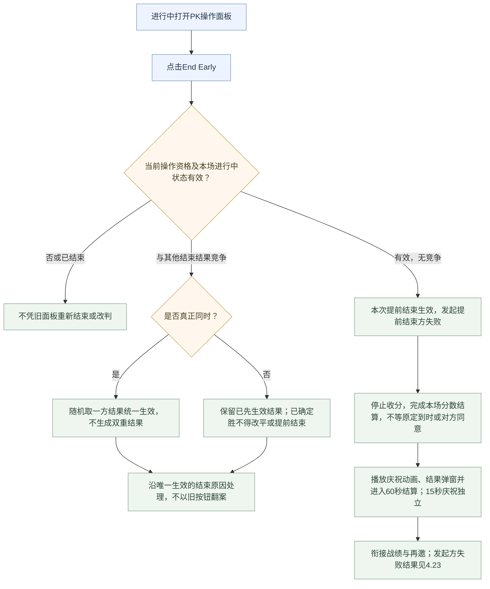

#### 4.22.6 状态与异常

| 场景 | 约束 |
|---|---|
| 发起提前结束方比分领先或双方同分 | 发起方仍按提前结束原因失败，不按积分改为胜利或平局 |
| 双方同时触发提前结束 | 真正同时随机取一方结果统一生效，不默认双方都败；非同刻保留已先生效结果 |
| 与原定到时或异常终止同时发生 | 真正同时随机取一方结果统一生效；非同刻保留已先生效结果，不用消息先后改判，已确定胜不能再改平或提前结束 |
| 数据异常 | 判负事实保留，不补0或按缺失比分翻案，不设置正常流程长期核对分支 |
| 重复点击、旧页面或迟到响应 | 不重复结束、不覆盖新局 |

### 4.23 失败结算

#### 4.23.1 页面定位与前置条件


正常结束判负及4.22提前结束发起方判负后展示失败结果。失败结果读取本场结束原因和已确认结果，不以低分或零分反推判负条件。

#### 4.23.2 页面展示与字段

本页凡展示双方房间ID，均按3.1：房主有靓号优先显示房主靓号ID，无靓号沿用原房间ID。

| 内容 | 字段 / 数据来源 | 展示说明 |
|---|---|---|
| 失败标题 | DEFEAT | 当前本房本场失败；提前结束生效时发起方按此失败方向处理 |
| 本房支持前三 | Top 3 supporters on my side | 读取本房本场送礼贡献前三，不取收礼MVP、对方榜单或双方合榜 |
| 头像位 | 本房支持者头像 | 身份、昵称超长跑马、同分先达到者靠前沿4.16；贡献人数不足3人按实际贡献人数展示，不补用户 |
| 本房PK分数 | PK Score | 展示本房本场已核对总分，不按固定0分或归零规则展示 |
| 房间公屏失败提示 | 房间消息区 | 展示失败提示，不是DEFEAT面板副标题 |
| 保存战绩 | 本场失败结果 | 将本场失败结果保存为本地图片，不扩为系统分享或奖励操作 |
| 再次发起 | 当前原对手 | 向原对手发新邀请，仍须当前资格校验及对方本次有效接受，不直接开局 |

保存本场结果图到本地，不扩社交分享；“再次发起”按4.18的新邀请链路处理。不新增独立关闭按钮或领取奖励操作。

#### 4.23.3 用户交互

- 展示本房失败结果后，按4.16已有榜单资料规则查看对应支持者资料。
- 点击“保存战绩”将本场失败结果保存为本地图片，不打开系统分享面板。点击“再次发起”按4.18向原对手发新邀请，不直接开局。关闭结果弹窗后不可重看，关闭不退出60秒阶段或撤回已发邀请。

#### 4.23.4 业务处理规则

- 正常结束按3.4的可靠积分比较确定失败；提前结束按4.22的发起方默认失败确定，不将提前结束判负重新送入积分高低或同分判平分支。
- 失败原因、胜负、比分、贡献榜、战绩均指同一场。判负不把本房贡献榜改成对方榜，也不将未核对分数填0。
- 正常到时或有效提前结束停止收分，分数结算完成后展示本场失败结果；不将长期核对设为正常流程。实际数据异常不补0或撤销已生效判负。
- 胜负对战效果、胜方庆祝、败方投降及独立15秒庆祝规则引用4.16；分数结算完成后播放庆祝动画、结果弹窗并进入60秒阶段，15秒独立；旧庆祝未播完时他人不能向该房发起PK。旧动画不得控制新局。
- 连胜及奖励不由DEFEAT画面自行计算。即使本房失败，只要最终达标仍按4.13～4.14获A；若本房唯一先达，C沿4.15，胜负不额外发个人奖。

#### 4.23.5 业务流程

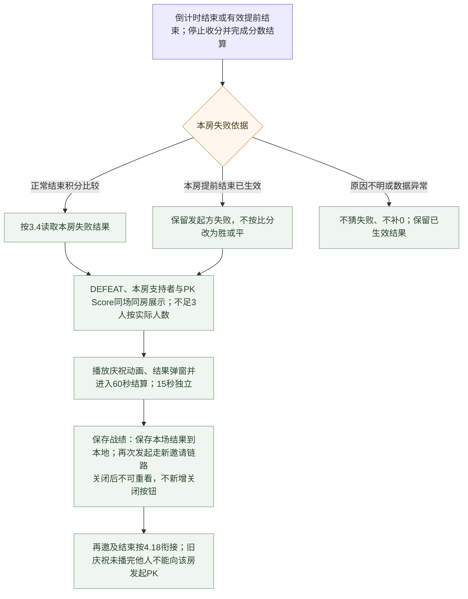

#### 4.23.6 状态与异常

| 场景 | 说明 |
|---|---|
| 本房因提前结束判负但当时比分较高 | DEFEAT仍由提前结束原因确定，不按分数改为胜利 |
| 数据异常或贡献不足三人 | 不补0、不造用户；不足三人按实际贡献人数展示 |
| 重复结果、重连或旧弹层 | 读取同场当前结果，不重复增加场次或改连胜；不由旧结果控制新局 |

### 4.24 首页PK展示

#### 4.24.1 页面定位与前置条件

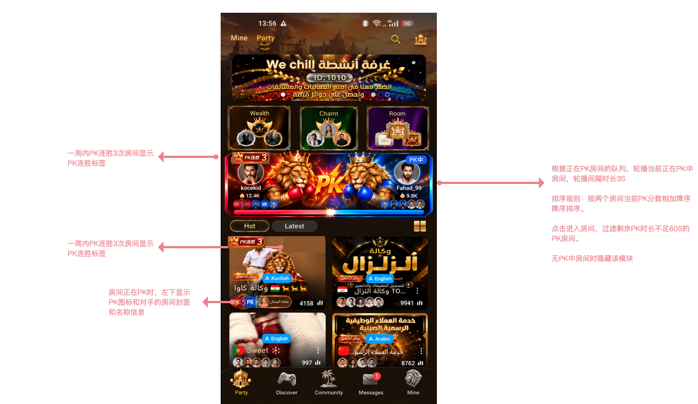

- 首页 Party 区域在房间列表上方展示正在PK的对阵模块；房间列表中的在PK房间卡片也承载PK状态和房间连胜标签。

#### 4.24.2 页面展示与字段

| 区域/字段 | 业务口径 |
|---|---|
| 首页PK对阵模块 | 展示当前正在PK的房间对阵；依据正在PK的房间队列轮播，无PK中房间时隐藏该模块 |
| 双方房间及当前PK分数 | 展示当前对阵的两房信息；排序值为两个房间**当前PK分数之和**，按合计值降序排列 |
| 轮播间隔 | 展示中的有效对阵按3秒间隔切换 |
| 入房候选剩余PK时长 | 剩余时长**不足60秒**的PK房间不能作为该入口的有效入房候选；恰好60秒未被此条排除 |
| 首页横幅连胜标签 | 一周内PK连胜3次的房间显示PK连胜标签；不把3当作连胜次数上限或独立奖励资格 |
| 房间列表连胜标签 | 与横幅对应的连胜标签展示规则一致 |
| 在PK房间卡片左下 | 该房间处于PK中时，在卡片左下展示PK图标及对手房间封面、名称 |

#### 4.24.3 用户交互

| 场景/操作 | 展示与结果 |
|---|---|
| 首页存在正在PK的有效展示对象 | 展示PK对阵模块，按当前队列排序并每3秒轮播 |
| 没有正在PK的房间 | 隐藏首页PK对阵模块；普通房间列表仍按既有页面能力展示，不因PK空队列消失 |
| 点击首页PK模块尝试进入房间 | 过滤剩余PK时长不足60秒的PK房间；对可进入候选执行原有入房能力 |
| 查看正在PK的房间卡片 | 左下可见PK图标和对手房间封面、名称；满足一周内PK连胜3次条件时显示PK连胜标签 |

#### 4.24.4 系统处理规则

1. 本模块消费**正在PK中**的对阵队列；两房当前PK分数合计仅用于首页对阵排序，不覆盖本场胜负、两房各自积分、结算榜单或PK战绩。
2. 轮播3秒间隔与“入房候选剩余PK时长不足60秒过滤”分别生效；不得把3秒当作查询刷新频率，也不得把60秒误用为整场剩余时间的强制终止阈值。
3. 首页一周3次连胜标签属于**展示条件**，不作为奖励发放依据。
4. 对手房间封面与名称随当前对阵显示；靓号/房间ID如在本页另行展示，遵循3.1统一口径。

#### 4.24.5 业务流程

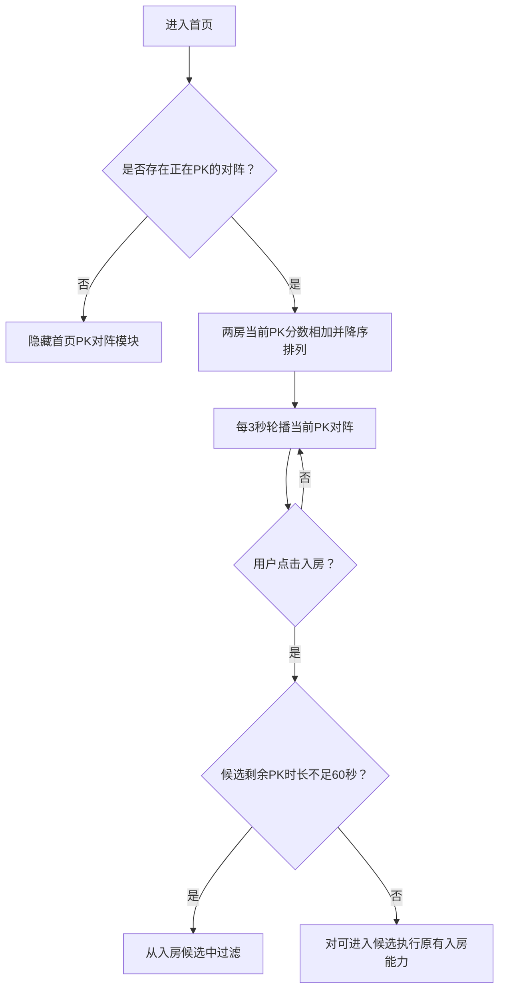

房间卡片的PK图标、对手封面/名称和连胜标签为与横幅并列的页面展示，不把卡片展示等同轮播队列或入房权限放行。

#### 4.24.6 状态与异常

| 场景 | 处理规则 |
|---|---|
| 对阵结束或无PK中房间 | 无PK中房间时隐藏该模块；结束对阵不再属于PK中候选 |
| 候选剩余时长不足60秒 | 过滤该PK房间作为有效入房候选 |
| 双房分数合计相同 | 仍按合计分为主要排序口径 |
| 房间进入PK或连胜状态变化 | 在PK卡片展示对手信息；符合一周内PK连胜3次条件显示标签 |

### 4.25 管理员权限设置

#### 4.25.1 页面定位与前置条件

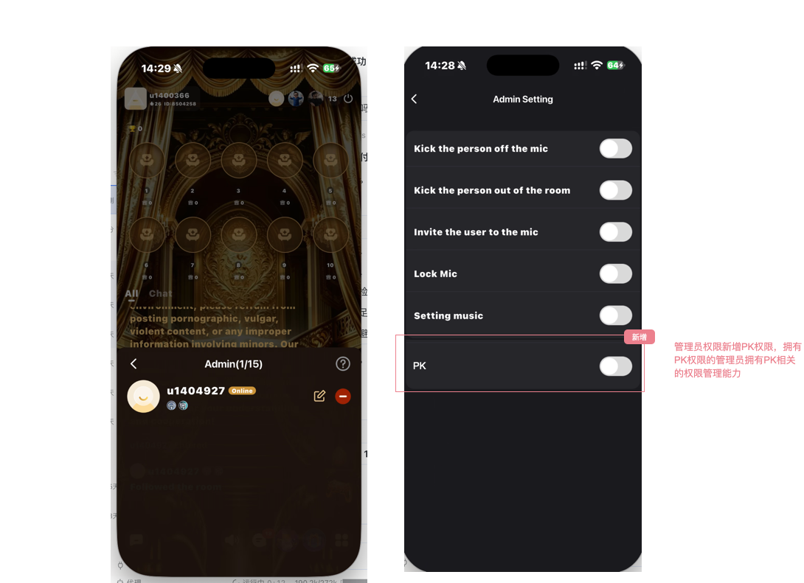

- 在 `Admin Setting` 管理员权限设置页新增独立「PK」权限项；下麦、踢出房间、邀请上麦、锁麦、音乐设置五项权限沿用既有能力。

#### 4.25.2 页面展示与字段

| 区域/字段 | 业务定义 |
|---|---|
| 管理员列表 | 标识被设置的管理员 |
| 设置页原有权限 | 下麦、踢出房间、邀请上麦、锁麦、音乐设置，不改既有语义与默认值 |
| `PK`权限项 | 为单个管理员独立配置PK权限；不能仅凭管理员身份推定获权 |

#### 4.25.3 用户交互

| 场景/操作 | 页面及业务结果 |
|---|---|
| 查看某管理员设置 | 在 `Admin Setting` 与原有权限并列展示独立「PK」项 |
| 管理员未获得当前PK授权 | 房间普通PK入口隐藏；已打开的旧页不得继续执行无权PK操作，见2、3.1和4.1 |
| 管理员获当前PK授权 | 可见入口并按当前资格发起；取消匹配还须为原发起者。首次接邀时接收房房主及有PK权限管理员可接/拒，以最先操作者为准；不因此自动取得设置、进行中提前结束操作权 |
| 调整或撤销PK授权 | 后续PK权限相关操作按当前有效授权复核；不因此撤回存量邀请或结束正在进行的比赛 |

#### 4.25.4 系统处理规则

1. PK权限独立于管理员身份和其他五项设置；身份、授权、当前房间和链路状态要分别校验。
2. 授权范围沿用2、3.1和4.1：未授权管理员无PK入口；已授权者仍按当前资格发起。邀请或随机匹配等待期间，不得由其他有权管理员代替原发起者操作，提示既定文案。结算阶段按钮仍须当前PK权限及当前链路限制。
3. PK权限撤销或管理员移除后，限制该成员后续PK权限相关操作；不据此自动终止比赛、撤回已发邀请、取消3秒准备。成局后PK跟随房间，不因管理员身份或权限变更中断；等待期撤权不另加接管、通知或特殊取消。房主目前不可变更。
4. PK黑名单仍按4.1及5.1既有方式处理，不新增PK黑名单设置页。

#### 4.25.5 业务流程

```mermaid
flowchart TD
  A["管理员权限设置页展示独立PK项"] --> D{"当前有效PK授权？"}
  D -->|无权| E["隐藏普通PK入口，禁止旧页执行无权操作"]
  D -->|有权| F["按已授权操作范围继续"]

  F --> G{"邀请或匹配等待期间是原发起者本人？"}
  G -->|否| H["有其他成员正在进行PK操作，无法继续操作PK。"]
  G -->|是| I["继续复核当前资格与有效链路"]
```

#### 4.25.6 状态与异常

| 场景 | 处理边界 |
|---|---|
| 获授权的管理员尝试PK动作 | 发起/取消/结算按钮按3.1复核；首次接邀接收房房主及有PK权限管理员可接/拒，最先操作者生效 |
| 等待中其他有权成员代操作 | 不允许，使用指定提示；原发起者失权后本人不得继续操作，不另加接管；同人限制不扩大到比赛全程 |
| 授权撤销后旧页仍在 | 后续权限相关操作受限；已成局PK继续随房间，不增补等待期撤权通知或特殊处置 |

## 5. 设置、运营支撑与生效边界

不新增后台菜单、表单、审批流或管理角色。

### 5.1 配置与管理

| 事项 | 业务规则 |
|---|---|
| 时长与默认值 | 默认20分钟，配置实时生效；旧选择被移除则关闭设置窗并toast“时长选项已更新，请重新设置。”；后续发起/匹配使用新默认档位。随机异时长本场取长不修改房间长期设置；历史时长不被后续房间设置覆盖 |
| PK模式排麦方式 | 自由麦、排麦模式二选一；记住上一次设置，未设置过默认排麦模式。分别复用无需房主审批上空缺麦位、房主或管理员审批后分配空缺麦位的既有逻辑 |
| 接受邀请偏好 | 保留总开关和推荐子项，移除好友子项；不影响随机候选；仅勾选今日拒邀后直接关闭不提交、不生效 |
| 管理员PK授权 | 独立PK权限项，未授权隐藏入口；首次接邀接收房房主及有PK权限管理员可接/拒，最先操作者生效；等待期撤权不增补接管，成局不因管理员变更中断 |
| PK黑名单 | 服务端手动将房间加入PK黑名单数据库表，被拉黑房间不得用PK，参与发起/接受资格复核；不新增管理页面 |
| 麦下收送礼计分 | 麦上一定计入；麦下由服务端控制，成员变动不追溯加减旧积分。CP礼物本房积分不得仅因收礼对象在外房而排除 |
| PK专用动画开关 | 中间送礼横幅和幸运礼物中奖动画有开关，仅PK模式可用；开关不改变送礼/中奖/积分事实 |
| 等待时限 | 邀请发起起总30秒未接受废弃；被拒可立即邀另一房；随机全程60秒/预估60秒，异时长10秒未响应退出；3秒动画播完自动开赛；真正同时随机择一生效 |

#### 5.1.1 A/C奖励承载与配置边界

| 事项 | 本期规则 |
|---|---|
| 达标目标 | A双方各自达标、C唯一先达分别记录；旧三档和x金币不进本期 |
| A物料 | 送礼名次1/2/3和MVP Host各对应不同样式1天头饰框 |
| C物料 | 先达房期间TOP1/2/3和期间送礼积分≥10000各有1天道具资格 |
| 本场依据 | A赛终榜与房间最终积分、C先达时点及期间榜分开留存；胜负连胜是另一来源；不能用新配置回填已发权益 |
| 履约核对 | 按场次、房间、用户、来源及角色/名次核对资格与到账；成功项不因重试重复发放 |

### 5.2 引导、背景与音频

| 项目 | 业务规则 |
|---|---|
| 首次引导 | 增加首次引导，按时间进度提示，见4.10 |
| PK背景 | PK模式强制切换PK房间背景，见4.10、4.19 |
| 音频服务 | 本期暂不增补不同音频服务兼容/降级方案 |

## 6. 进行中提前结束与异常恢复

“进行中提前结束”与4.18的“立即结束结算展示”不是同一操作。前者为发起方默认失败，立即结束本场并进入结束流程，见4.22；后者只退出双方旧局结算展示，不改变已核定结果。具体操作权限分别校验，不能互相套用。

### 6.1 提前结束规则与结束衔接

- **发起提前结束PK方，默认为PK失败方。提前结束PK后，立即结束PK进入结束流程。** 操作面板、字段、用户交互、业务规则及详细流程见4.22，失败结果展示见4.23。
- 不增加确认窗或等待对方响应步骤。
- 提前结束按实际生效结束本场，不继续等待原定比赛到时。
- 提前结束判负不改变比分/榜单事实来源；有效结束即停止收分，分数结算完成后播放结果表现、展示结果弹窗并进入60秒结算，期间送礼不加PK分。不跳过结算阶段；真实故障结果未确认时不伪造分数或放开下一局邀请。
- 真正同时的提前结束/到时等竞争随机择一结果统一生效；非同时按已生效状态处理，已确定胜利不能被旧提前结束动作改写。

### 6.2 故障分类与处理边界

#### 6.2.1 服务端异常处理边界

| 场景 | 处理约束 |
|---|---|
| 普通观众/某主播离房、下麦 | 沿用原房间能力；已有贡献不随成员迁移或抹除；无人上麦不直接当房间关闭 |
| 单个客户端掉线、切后台 | 读取当前真实剩余时长、积分和榜单；不因本端动画缺失重开或重算；单人断网不直接判整房退出或判负 |
| 房主离开但房间仍有效 | 与实际关房分开；房主目前不可变更，不设置转让接管路径；邀请/匹配等待不由其他成员代操作，不默认自动接受邀请 |
| 双房同时不可用、反复掉线 | 不能凭最先发现哪边断线判负 |
| 只有音频/聊天/动画故障 | 与成功送礼事实、计分事实分开；不直接结束比赛、判消费失败或按缺动画补扣/补分；声音控制仍按4.10 |
| 关键计分事实无法核验 | 不由“核对中”提示倒推本场已结束；不伪造结果；结果未核对完成禁发/接下一局邀请 |
| 邀请未送达/接收人离线 | 无响应不默认同意；发起起总30秒未接受废弃，不因离线重置期限；过期弹窗不得重启旧邀请 |
| 3秒动画与客户端状态 | 有效接受或命中成局后自动按流程继续，动画播完开赛，无需双方确认就绪；此前不计PK分，不设置可靠就绪/准备超时恢复门槛 |
| 成功礼物通知迟到/乱序/重复 | 显示消息不创造新的礼物或分数，不把迟到动画记新局 |
| 已发再邀后结束旧展示 | 保留该邀请原有效期及占用；不能撤回邀请、放开第三方或用旧展示事件结束新局 |
| 真实故障导致结果无法确认 | 正常结束不设长期核对等待；分数结算完成后进入结果/60秒阶段；真实故障未确认结果仍禁发/接下一局邀请；不虚构自动平局或永久封锁 |

#### 6.2.2 关键计分事实异常与结果核对

```mermaid
flowchart TD
  A["关键计分事实无法核验"] --> B["保留已知事实与已生效结果；不猜胜负、不补0"]
  B --> C["结果未核对完成，禁止发起或接受下一局邀请；关闭展示或60秒到时不解除"]
  C --> D{"本场可靠结果是否完成核对？"}
  D -->|已完成| E["按本场可靠结果读取胜负、比分和榜单；分数结算完成后结果表现、弹窗与60秒结算同时开始"]
  D -->|尚未完成| F["保持核对未完成事实，不强行判平局、判负或编造结果"]
  classDef decision fill:#fff7df,stroke:#bb9846,color:#554315
  classDef result fill:#f0f5f2,stroke:#86a38d,color:#2e4533
  class D decision
  class B,C,E,F result
```

### 6.3 结果唯一性与纠正

- 每场只有一个有效结束原因和结果；真正同时的竞争随机择一统一生效，非同时按已生效状态；首次接邀接/拒以最先操作者为准。重复/迟到通知不重复成局、结算、战绩或连胜。
- 关闭结果窗、15秒动画结束、60秒到时或立即结束展示均不改写已定比分/胜负；已定胜利不改平或重新提前结束。结果窗关闭不可重看；庆祝未播完他人不得向该房发邀。

- 本期不考虑历史退款引发的结算后追溯改判，不新增退款重算胜负、连胜或人工改分。
- A/C资格来源沿4.13～4.15；重试不得重复发已成功项。

